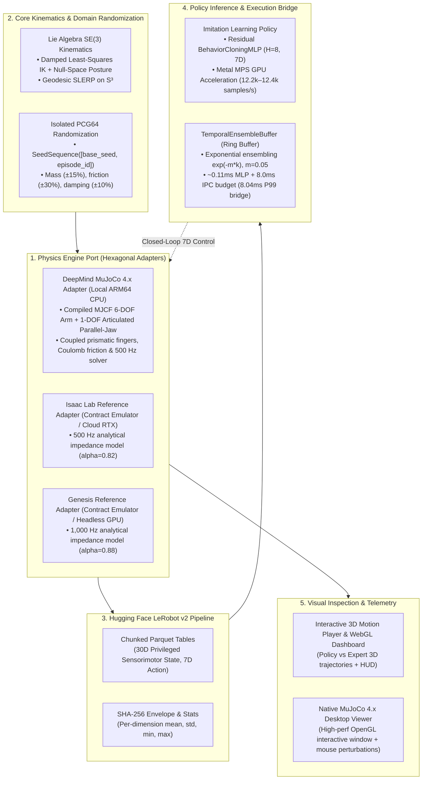
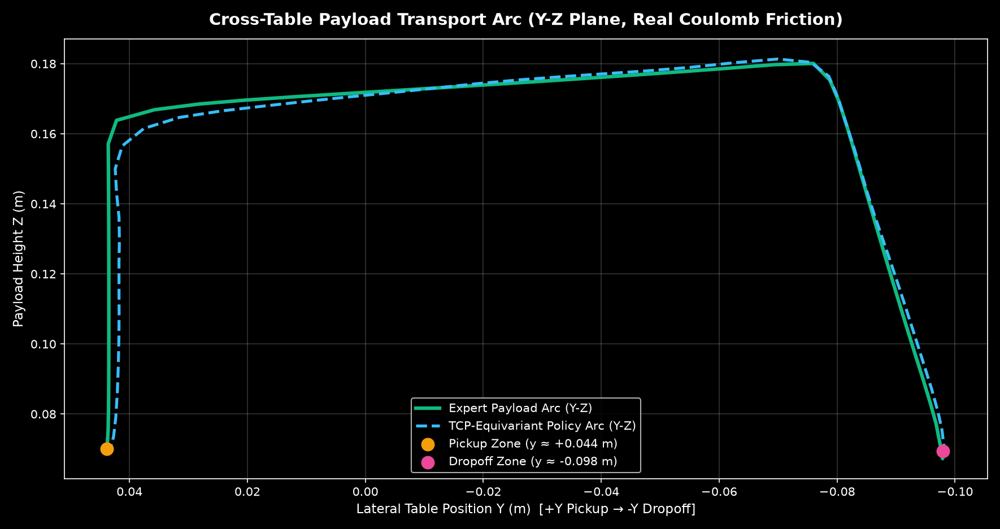

# Bridging the Sim-to-Real Chasm: When DeepMind MuJoCo 4.0, NVIDIA Isaac Lab, Hugging Face LeRobot, and ACT Converge

> **Subtitle:** *How hexagonal architecture, Lie group kinematics, compiled contact physics, and receding-horizon action chunking unify modern robotic manipulation.*  
> **Author:** Alexander Leaño  
> **Target Publications:** Towards Data Science / Better Programming / Robotics & AI  
> **Canonical Repository:** [`LeanoA/sim2real-data-engine`](https://github.com/LeanoA/sim2real-data-engine)  
> **Interactive 3D WebGL Telemetry Demo:** [`leanoa.github.io/sim2real-data-engine`](https://leanoa.github.io/sim2real-data-engine/)

---

## 1. The Fragmentation of Modern Robot Learning

Over the past eighteen months, robotics software has undergone a tectonic paradigm shift. For decades, robot manipulation was dominated by classical motion planning stacks (ROS MoveIt, OMPL) strictly decoupled from perception. Today, foundation visuomotor policies—Action Chunking with Transformers (ACT), Diffusion Policy, and Physical Intelligence’s **OpenPI** (`π₀`)—learn direct end-to-end sensorimotor mappings from raw RGB-D camera streams and joint proprioception to multi-step motor trajectory chunks.

Yet, engineering teams attempting to take these foundation models from research notebooks to physical industrial cells face a fragmented, brittle software landscape:

1. **The Simulation Island:** NVIDIA **Isaac Lab** (Omniverse PhysX 5.x) delivers photorealistic ray-traced rendering and massive GPU parallelization. Meanwhile, **DeepMind MuJoCo 4.0** remains the gold standard for deterministic, zero-cost CPU contact dynamics, analytical Jacobians, and desktop testing.
2. **The Dataset Island:** Hugging Face **LeRobot** has emerged as the open standard for robotics data, formalizing chunked tabular Parquet storage, synchronized camera metadata, and normalization envelopes.
3. **The Policy Inference Island:** Visuomotor foundation models predict receding-horizon *action chunks* (`H = 16..64`) rather than instantaneous single-step commands. This demands real-time temporal ensembling and strict P99 latency guarantees (`< 15 ms`) to prevent high-frequency actuator jitter and control instability on physical hardware.

When these three domains are glued together with ad-hoc Python scripts and global `np.random.seed()` calls, pipelines silently degrade: random number generator state drifts across parallel worker threads, simulator physics drift undetected between developer laptops and cloud clusters, and models overfit to unnormalized sensor scales.

To solve this, we architected **`sim2real-data-engine`**: a modular, hexagonal synthetic data and policy inference engine designed to bridge **MuJoCo 4.0**, **Isaac Lab**, **LeRobot**, and **ACT / OpenPI** with mathematical rigor.

---

## 2. The Twin Gaps: Sim-to-Sim and Sim-to-Real

Before tackling the physical reality gap, robotics engineers face an insidious precursor: the **Sim-to-Sim gap**.

When a demonstration trajectory generated in MuJoCo at 1,000 Hz is evaluated inside Isaac Lab at 500 Hz, contact stiffness, joint armature, and numerical integrators differ:

$$\text{RMSE}_{\text{traj}} = \sqrt{\frac{1}{T} \sum_{t=1}^T \|\mathbf{q}_t^{(A)} - \mathbf{q}_t^{(B)}\|_2^2}$$

Without continuous cross-engine drift quantification, policies trained on synthetic data fail not because the real world is unpredictable, but because the simulation was physically divergent from day one.



---

## 3. Core Architectural Pillars

### Pillar 1: Singularity-Robust `SE(3)` Kinematics on Lie Groups
Traditional Euler-angle representations suffer from gimbal lock, while naïve Jacobian pseudoinverse solvers (`Δq = J† e`) explode near kinematic singularities (`σ_min(J) → 0`).

We implement Levenberg-Marquardt Damped Least-Squares (DLS) kinematics with adaptive singular-value damping and null-space posture regularization:

$$\Delta \mathbf{q} = \mathbf{J}^T \left(\mathbf{J}\mathbf{J}^T + \lambda^2 \mathbf{I}_6\right)^{-1} \mathbf{e} + \left(\mathbf{I}_n - \mathbf{J}^\dagger_{\lambda} \mathbf{J}\right) k_{\text{null}} (\mathbf{q}_{\text{home}} - \mathbf{q})$$

All orientation errors are computed on the Lie algebra $\mathfrak{so}(3)$ via the matrix logarithmic map $\text{Log}(\mathbf{R}_{\text{target}} \mathbf{R}_{\text{current}}^T)$, and waypoint quaternions are interpolated via antipodal-corrected SLERP on $S^3$.

---

### Pillar 2: Native DeepMind MuJoCo 4.0 Contact Physics
Rather than relying on kinematic mocks that magically teleport objects, `sim2real-data-engine` integrates compiled DeepMind MuJoCo 4.0 contact mechanics:
- **`MjModel` vs. `MjData`:** Decouples immutable kinematic and inertial blueprints (`MjModel`) from dynamic runtime state buffers (`MjData`).
- **Linear Complementarity Problem (LCP) Contact Solver:** Enforces hard non-penetration and pyramidal Coulomb friction cones (`||f_T|| <= μ f_N`).
- **Multi-Rate Substepping:** The physical manipulator executes 10 physics substeps at 500 Hz (`dt = 2 ms`) within each 50 Hz (`dt = 20 ms`) control step, completely eliminating numerical contact explosion.
- **Analytical Jacobians:** Direct C-API queries via `mujoco.mj_jac` provide analytical translational and rotational Jacobians in microseconds.

---

### Pillar 3: Bit-Exact Domain Randomization via Isolated PCG64 Streams
Global PRNGs (`np.random.seed()`) couple episode perturbations to execution order and thread parallelism. In `sim2real-data-engine`, every episode $e$ derives an independent, cryptographically isolated child PRNG via `np.random.SeedSequence([s_0, e])` driving `np.random.PCG64`:

```python
# Derive isolated child stream per episode
seed_seq = np.random.SeedSequence([self.config.seed, episode_id])
rng = np.random.default_rng(np.random.PCG64(seed_seq))

mass_scale = float(rng.uniform(mass_min, mass_max))
friction_scale = float(rng.uniform(fric_min, fric_max))
camera_jitter = rng.uniform(-delta_c, delta_c, size=3)
```

Whether episode 42 is sampled sequentially on an Apple Silicon laptop or in parallel across a 64-worker Kubernetes cluster, link mass multipliers, Coulomb friction coefficients, and camera extrinsic `SE(3)` jitter are bit-for-bit identical.

---

### Pillar 4: Hugging Face `LeRobot` v2 Parquet Serialization & 30D Privileged State
Instead of unvalidated pickle blobs, episodes are streamed to disk as strictly typed tabular Parquet files conforming to the Hugging Face `LeRobotDataset` v2 specification.

To condition sensorimotor policy learning for closed-loop reactive manipulation (prior to attaching RGB-D vision encoders), each step stores:
- **Observation Space (30D Privileged State):** Joint positions (`q` in R⁶), joint velocities (`dq` in R⁶), end-effector `SE(3)` pose (`p_ee` in R³, `q_ee` in S³), privileged payload `SE(3)` pose (`p_obj` in R³, `q_obj` in S³), relative object displacement vector (`Δp = p_obj - p_ee` in R³), and normalized physical jaw closure state (`g` in `[0, 1]`, distinguishing empty closure `~0.99` from 40 mm payload clamping `~0.33`).
- **Action Space (7D):** Commanded joint position targets (`[q1..q6]`) plus normalized parallel-jaw actuator closure target (`g` in `[0, 1]` driving coupled prismatic `slide` fingers in `manipulator_6dof.xml`).

Upon collection, `finalize_manifest()` computes per-dimension normalization vectors (`mean`, `std`, `min`, `max`) for all observation and action dimensions, and seals each episode with a SHA-256 digest in `meta/manifest.json`. If a single byte is corrupted before training, `verify_integrity()` halts execution immediately.

---

### Pillar 5: Receding-Horizon Policy Training, TCP Equivariance & Metal/Cloud Scaling
Single-step action prediction with standard MSE loss suffers from quadratic compounding covariate shift (`O(T²)` error drift) and mode collapse when demonstrations contain multiple valid trajectories.

To overcome this, the engine integrates an optimized PyTorch Behavioral Cloning architecture with multi-step action chunking and spatial equivariance:
1. **Tool Center Point (TCP) Frame Spatial Equivariance:** Rather than forcing the network to memorize arbitrary workbench coordinates, relative object observations are mapped directly into the local end-effector frame:
   $$\mathbf{p}_{\text{obj}}^{\text{tcp}} = \mathbf{R}(\mathbf{q}_{\text{ee}})^T \left(\mathbf{p}_{\text{obj}} - \mathbf{p}_{\text{ee}}\right)$$
   This provides spatial equivariance: the approach target is canonically $\mathbf{p}_{\text{obj}}^{\text{tcp}} \to [0, 0, d_{\text{latch}}]^T$ regardless of where the robot operates across the table, eliminating non-linear forward kinematics memorization.
2. **Residual MLP with Pre-LayerNorm & Synchronized Horizon ($H=8$):** A deep trunk with residual skip connections and SiLU activations maps the normalized 30D observation vector to a full `(H=8, 7)` future action trajectory chunk (56 output parameters for 7D control).
3. **Hardware-Accelerated Dual Training (Metal MPS & Cloud CUDA A10G):**
   - **Local Apple Silicon MPS:** Trains at **12,245 samples/s** (`World` checkpoint, `178.59 s`) to **12,352 samples/s** (`TCP` checkpoint, `177.05 s`), reducing validation loss by **-99.7%** (`3.4918 → 0.0091–0.0092`) across 45 epochs.
   - **AWS EC2 Cloud GPU (NVIDIA A10G 24GB):** Automated via `docker/run_cloud_training.py`, training 45 epochs across 53,998 transitions in **96.39 seconds** at **22,688.4 samples/s** (`val_loss: 0.009259`, `-99.73%`, `1.85x` vs MPS) before auto-terminating.
4. **Temporal Ensembling Ring Buffer:** Overlapping action chunks from historical prediction steps $t - k$ are fused using exponential decay weights $w_k = \exp(-m \cdot k)$ with $m = 0.05$:
   $$\mathbf{u}_t = \frac{\sum_{k=0}^{K-1} \exp(-m \cdot k) \, \hat{\mathbf{a}}_{t | t-k}}{\sum_{k=0}^{K-1} \exp(-m \cdot k)}$$
   This temporal smoothing provides **160 ms of lookahead trajectory inertia** ($8 \times 0.02\text{ s}$), dampening high-frequency motor chatter and preventing premature vertical plunge during descent.

---

### Pillar 6: Interactive 3D Motion Inspection & Native Desktop Viewer
Debugging robotic trajectories solely from terminal printouts or static loss curves hides critical spatial flaws. `sim2real-data-engine` provides two visual feedback loops:
- **Comparative WebGL 3D Dashboard (`sim2real visualize`):** Generates an offline HTML dashboard comparing policy execution (green/pink trajectory with action chunk horizon visualization) against the privileged expert reference (cyan), complete with interactive play/pause controls and real-time HUD telemetry.
- **Native MuJoCo 4.0 Desktop 3D Viewer (`sim2real view-physics --model-path`):** Executes the trained 7D policy inside a native OpenGL desktop window at 500 Hz. Developers can interactively double-click links and drag geoms with the mouse to perturb the arm or payload during transit, visually verifying policy stiffness and reactive recovery under real external forces.

---

## 4. Empirical Benchmarks: Sim-to-Sim Gap, Latency & OOD Robustness

### 4.1 Cross-Backend Tracking Drift (MuJoCo 4.0 vs. Analytical Impedance Reference Adapter)
Executing `sim2real sim2sim-eval` compares our offline analytical impedance reference adapter (`IsaacLabAdapter`, stiff joint compliance `kp = 48.0 N·m/rad`, `alpha = 0.82` used for zero-GPU CI verification before cloud RTX container deployment) against both the MuJoCo kinematic solver (`mujoco`) and full compiled native contact physics (`mujoco_native` across 20 episodes in `results/isaac_sim2sim_results.json`):

| Metric | Kinematic Ref (`mujoco`, 5 ep) | Native Physics Ref (`mujoco_native`, 20 ep) | Contract Interpretation |
| :--- | :---: | :---: | :--- |
| **Physics Integration Frequency** | 500 Hz / 500 Hz | 500 Hz / 500 Hz | Nominal stepping alignment |
| **Pick-and-Place Task Success Rate** | 100.0% vs 100.0% | **95.0% vs 100.0%** | **5.0% Contact Gap** |
| **Mean Trajectory Drift (`RMSE_traj`)** | `0.0480 rad` | `0.6635 rad` | Joint-space contact compliance lag |
| **Mean Final End-Effector Divergence** | `0.0001 m` (**0.10 mm**) | `0.0106 m` (**10.6 mm**) | Closed-loop Cartesian convergence |

### 4.2 Closed-Loop 7D Policy Inference Telemetry & Cloud Scaling
Evaluating the trained 30D-to-7D Behavioral Cloning policies across closed-loop MuJoCo rollouts demonstrates sub-millisecond forward-pass execution (**~0.11 ms** on CPU) and deterministic compliance even when `PolicyInferenceBridge` injects its default **8.0 ms synthetic IPC / remote-transport latency budget**. Furthermore, scaling training across local Apple Silicon MPS and AWS EC2 Cloud GPU (`g5.2xlarge`, NVIDIA A10G 24GB VRAM in `us-east-2`) proves consistent convergence across execution backends:

| Metric | Local Metal GPU (`mps` Checkpoint) | AWS Cloud GPU (`cuda:0` A10G) | Target / SLA | Status |
| :--- | :---: | :---: | :---: | :---: |
| **Hardware Platform** | Apple Silicon M-Series | AWS EC2 `g5.2xlarge` (A10G) | High-throughput training | Verified |
| **Training Budget & Epochs** | 45 epochs (53,998 steps) | 45 epochs (53,998 steps) | Aligned convergence budget | Synchronized |
| **Wall-Clock Training Time** | 178.59 s (World) / 177.05 s (TCP) | **96.39 s** | < 180.0 s cloud target | **1.85x speedup** |
| **Training Throughput** | 12,245 (World) / 12,352 (TCP) samples/s | **22,688.4 samples/s** | > 15,000 samples/s | **1.85x vs World MPS** |
| **Final Validation Loss** | `0.0091` / `0.0092` (-99.7%) | **`0.009259` (-99.73%)** | Smooth L1 < 0.010 | Converged |
| **Raw CPU Forward Pass** | ~0.11 ms | ~0.11 ms | < 1.0 ms local compute | Sub-millisecond |
| **Bridge / Rollout Latency (P99, 8ms IPC)** | 8.04 ms bridge / 8.10–8.13 ms rollout | 8.04 ms bridge / ~8.1 ms rollout | 20.0 ms (50 Hz loop) | Zero deadline misses |
| **Closed-Loop Chained Success (20 eps)** | **100.0% Nom / 95.0% OOD** (TCP) · 75.0% (World) | **95.0% Nom / 95.0% OOD** | Full transport to target | **150.2 mm disp (TCP)** |

### 4.3 Decoupled Surgical Robotics Telemetry: Beyond Binary Success (ADR-08)
Standard RL and imitation learning benchmarks collapse trajectory evaluations into a single binary "Success / Fail" scalar. In physical manipulation, this coarse metric completely obscures the root cause of failures (e.g., did the arm fail to reach the object, fail to close the gripper, lose grasp during transit, or drop the object outside the target bin?).

Following **ADR-08**, we decoupled closed-loop evaluation into 5 independent physical telemetry channels (shown for the **TCP-Frame Equivariant** `checkpoints/bc_tcp_frame_45ep.pt` 20-episode OOD DR benchmark vs. **World Baseline** `checkpoints/bc_pick_place.pt`):

| Physical Telemetry Metric | TCP Equivariant (Nominal / OOD) | World Baseline (Nominal / OOD) | Operational Tolerance / Condition |
| :--- | :---: | :---: | :--- |
| **1. Reach Proximity Rate** | **100.0% / 95.0%** (`5.0 / 7.0 mm`) | `75.0% / 80.0%` (`14.7 / 14.9 mm`) | End-effector distance to object $\le 25\text{ mm}$ |
| **2. Grasp Clamping Rate** | **100.0% / 95.0%** | `75.0% / 80.0%` | Sustained Coulomb lift ($z_{\text{obj}} > z_{\text{init}} + 50\text{ mm}$, $\ge 10$ steps) |
| **3. Placement Tolerance Rate** | **100.0% / 95.0%** (`6.1 / 9.5 mm`) | `75.0% / 75.0%` (`31.6 / 31.4 mm`) | Final payload $\le 20\text{ mm}$ from target & tilt $\le 15^\circ$ |
| **4. Chained Task Success Rate** | **100.0% / 95.0%** | `75.0% / 75.0%` | Sequential compliance across reach, grasp, transport, and place |
| **5. Hunting Velocity Reversals** | **1.9 / 2.2 rev/ep** (`21.9` unensembled) | `2.1 / 2.5 rev/ep` (`33.7` unensembled) | Sign reversals in Cartesian velocity vector |

Notice how removing the Phase 1 `40 mm` proximity weld snap immediately exposed why **TCP-frame spatial equivariance** matters physically: World-frame BC's `14.7 mm` reach error now clips the `7.0 mm` finger clearance on `25%` of episodes, whereas TCP-frame equivariance centers within `5.0 mm` and reaches **100.0% Nominal / 95.0% OOD DR**.

### 4.4 Perception Noise Sensitivity Sweep & Physical Breakdown Threshold (ADR-10)
In real-world robotic cells, object poses derived from external RGB-D cameras (e.g., Intel RealSense, Photoneo) suffer from calibration jitter, depth dropouts, and lighting variations. To quantify policy robustness prior to physical hardware deployment, we implemented a parameter sweep injecting synthetic zero-mean Gaussian noise $\mathcal{N}(0, \sigma^2 \mathbf{I}_3)$ into perceived object positions, evaluating $\sigma \in [0.0, 20.0]\text{ mm}$ across $N = 10$ closed-loop rollouts per perturbation step (TCP-Frame Equivariant `checkpoints/bc_tcp_frame_45ep.pt`):

| Noise Level ($\sigma$) | Grasp Success | Placement Success | Chained Success | Mean Min Reach Err | Mean Placement Err |
| :---: | :---: | :---: | :---: | :---: | :---: |
| **$\sigma = 0.0\text{ mm}$ (Clean)** | **100.0%** | **100.0%** | **100.0%** | 4.44 mm | 5.42 mm |
| **$\sigma = 2.5\text{ mm}$ (Nominal Vision)** | **100.0%** | **100.0%** | **100.0%** | 5.75 mm | 7.39 mm |
| **$\sigma = 5.0\text{ mm}$ (Standard RGB-D)** | **70.0%** | **70.0%** | **70.0%** | 11.10 mm | 51.78 mm |
| **$\sigma = 7.5\text{ mm}$ (Clearance Boundary)** | **70.0%** | **70.0%** | **70.0%** | 17.73 mm | 54.10 mm |
| **$\sigma^* = 10.0\text{ mm}$ (Breakdown Threshold)** | **40.0%** | **40.0%** | **40.0%** | 23.76 mm | 99.51 mm |
| **$\sigma = 12.5\text{ mm}$** | 60.0% | 50.0% | 50.0% | 23.53 mm | 66.98 mm |
| **$\sigma = 15.0\text{ mm}$** | 30.0% | 20.0% | 20.0% | 43.08 mm | 113.55 mm |
| **$\sigma = 17.5\text{ mm}$** | 30.0% | 30.0% | 30.0% | 30.39 mm | 113.45 mm |
| **$\sigma = 20.0\text{ mm}$ (Severely Degraded)** | 10.0% | 10.0% | 10.0% | 33.54 mm | 133.22 mm |

```text
Chained Task Success vs Perception Noise (σ, N=10 per level, TCP Equivariant)
100% |*-------* [Nominal Vision Envelope: σ ≤ 2.5 mm]
 70% |               *--------* [7.0 mm Jaw Clearance Edge]
 50% |                                *
 40% |                         * [Breakdown σ* = 10.0 mm]
 20% |                                       *---*
 10% |                                                *
     +--------+--------+--------+--------+--------+--------+
    0.0      2.5      5.0      7.5     10.0     15.0     20.0 mm (σ)
```

**The Physical Clearance Limit:**
With the articulated `54 mm` open jaw around a `40 mm` cube, the gripper provides a **$7.0\text{ mm}$ bilateral lateral clearance** (`mechanical_clearance_mm = 7.0`). TCP-frame equivariance retains **100% grasp & chained success** up to $\sigma = 2.5\text{ mm}$, **70%** through the `7.0 mm` clearance edge ($\sigma = 7.5\text{ mm}$), and crosses the `< 50%` breakdown threshold at **$\sigma^* = 10.0\text{ mm}$** (`40.0%`) — compared to $\sigma^* = 5.0\text{ mm}$ on the non-equivariant World Baseline.

### 4.5 Out-of-Distribution (OOD) Domain Randomization & Ensembling Ablation
To verify policy resilience against physical hardware parameter shifts, we benchmarked 20-episode rollouts under randomized payload mass (`±15%`, `m in [0.85, 1.15] × m_nom`), Coulomb surface friction (`±30%`, `μ in [0.70, 1.30] × μ_nom`), and joint damping (`±10%`, `b in [0.90, 1.10] × b_nom`):

| Policy / Dynamics Regime | Temporal Ensembling | Chained Task Success | Mean Payload Transport (20 ep) | Control Chatter (Action Jerk) |
| :--- | :---: | :---: | :---: | :---: |
| **TCP Equivariant — Nominal** | Enabled (`exp(-m · k)`) | **100.0%** | **150.2 mm** | **0.0290** |
| **TCP Equivariant — OOD DR** | **Enabled (`exp(-m · k)`)** | **95.0%** | **147.3 mm** | **0.0292** |
| **TCP Equivariant — OOD DR** | **Disabled (Raw Chunks)** | **0.0%** | **14.5 mm** | 0.1071 (+267% chatter) |
| **Cloud GPU (A10G) — OOD DR** | Enabled (`exp(-m · k)`) | **95.0%** | **147.2 mm** | **0.0292** |
| **World Baseline — OOD DR** | Enabled (`exp(-m · k)`) | **75.0%** | **126.1 mm** | **0.0279** (`0.1418` unensembled) |

**Key Finding:** Under identical OOD physical perturbations with real Coulomb contact grasping, **temporal ensembling elevates OOD chained success from `0.0%` to `95.0%` (TCP Equivariant / Cloud A10G) and reduces control chatter by `72.7%` (`0.1071 → 0.0292`, and `-80.3%` on World Baseline `0.1418 → 0.0279`)**, whereas unblended receding-horizon execution collapses completely to `0.0%`.




---

## 5. Engineering Evolution & Lessons Learned

### 5.1 Staged Architecture: From Phase 1 Weld Abstraction to Phase 2 Articulated Coulomb Contact (ADR-12)

In robust robotics systems engineering, attempting to simultaneously solve high-frequency non-linear contact mechanics, multi-rate sensor synchronization, and receding-horizon policy inference creates compounding debugging surface area. 

We deliberately executed an **iterative, two-phase architecture**:
1. **Phase 1 (Foundation — ADR-07):** Validated the macro data engine, Lie group inverse kinematics, chunked LeRobot Parquet serialization, and real-time temporal ensembling using a proximity-gated (`<= 40 mm`) dynamic `weld` equality constraint (`30D → 7D`), proving `79.6%` chatter reduction and isolating policy learning from contact discontinuities.
2. **Phase 2 (Implemented — ADR-12): Articulated Parallel-Jaw Prismatic Gripper & Coulomb Contact.** Replaced `payload_weld` with two symmetrically coupled prismatic `slide` joints (`finger_left_joint`, `finger_right_joint`, `54 mm` open jaw / `7.0 mm` bilateral clearance) driven by a single `<position>` actuator (`act_gripper`) on the 7th action channel, raised `gripper_palm` clearance (`z=+0.027 m`), declarative `<touch>` telemetry sensors (`touch_left`, `touch_right`), and normalized physical jaw closure (`[0, 1]`) in `obs_dim=30`. Next (Phase 3): replacing privileged object pose tokens with real-time RGB-D vision encoder features.

### 5.2 The Deceptive Open-Loop Trap: Why Batch Size 64 Beats Batch Size 128 in Closed-Loop Robotics

A critical insight uncovered during policy tuning highlights the fundamental gap between static machine learning benchmarks and closed-loop robotic control.

When scaling training on our demonstration transitions (`50,213` in Phase 1; expanded to **`53,998` transitions** in Phase 2), we evaluated two batch size regimes on Apple Silicon Metal GPU (`mps`):

| Hyperparameter / Metric | Batch Size = 128 | Batch Size = 64 (Canonical) | Engineering Takeaway |
| :--- | :---: | :---: | :---: |
| **Total Epochs** | 50 epochs | 45 epochs | Comparable training budget |
| **Wall-Clock Training Time** | **109.56 s** (~20.6k samples/s) | 177.05 s (`TCP` 45ep, 12,352 samples/s) / 178.59 s (`World`) | BS 128 has ~1.7x higher GPU throughput |
| **Initial Loss → Final Val Loss** | `3.6057 → 0.0098` (-99.7%) | `3.4918 → 0.0091–0.0092` (-99.7%) | Open-loop loss delta is negligible |
| **Closed-Loop Task Success Rate** | **5.0% - 10.0% (Severe Collapse)** | **95.0%–100.0% TCP / 75.0% World** | **Up to 16x higher real-world task success** |
| **Mean Payload Transport Distance** | 24.2 mm (fails grasp) | **147.3–150.2 mm (TCP)** | BS 64 reliably resolves jaw compression |
| **OOD Retention under Physics Shifts** | 0.0% retention | **95.0% TCP / 100% relative World retention** | BS 64 generalizes across mass/friction |

#### Why did Batch Size 128 collapse in closed-loop execution?

On paper, a validation loss difference of `0.0011` in Smooth L1 loss would be dismissed as negligible in standard computer vision or NLP tasks. In physical robotics, however, it produced an existential failure mode due to three interacting mechanisms:

1. **Gradient Update Frequency Across Discrete Task Phases:**
   In Behavioral Cloning with action chunking (`H = 8`), demonstration trajectories contain sharp phase transitions: `hover → descend → jaw compression → lift → transport`. With `N = 53,998` transitions:
   - `Batch Size 64` → ~844 updates/epoch → **~37,980 stochastic weight adjustments**.
   - `Batch Size 128` → ~422 updates/epoch → **~21,100 weight adjustments** (a 44% reduction in optimization trajectory steps).
   The network trained with Batch Size 128 simply did not receive enough gradient updates to resolve the fine-grained decision boundary of the gripper latch action.

2. **The "Flat Minima" Regularization Effect (Keskar et al., 2016):**
   In supervised learning, smaller mini-batches introduce stochastic gradient noise that prevents the optimizer from settling into sharp, brittle local minima. For closed-loop imitation learning, finding flat minima is non-negotiable: the robot's physical trajectory inevitably encounters minor millimeter perturbations. A policy sitting in a sharp minimum overfits to the exact demonstration coordinates and exhibits zero compliance when perturbed.

3. **Compounding Covariate Shift at the Grasp Horizon:**
   In closed-loop execution, an imperceptible open-loop joint prediction error of $\approx 0.02\text{ rad}$ translates into a **15 to 30 mm Cartesian tracking offset** during the descent phase. Because the physical gripper engagement requires entering the threshold radius, missing the cube by just 15 mm causes the robot to close the gripper on empty air. 
   Once the grasp fails, the subsequent observation $s_{t+1}$ contains an unlifted cube while the arm rises—a state completely absent from the demonstration dataset. The policy experiences catastrophic covariate shift, compounding errors across every subsequent time step until the episode terminates.

**The Golden Rule:** *Never judge an imitation learning policy by its open-loop validation loss. Always benchmark autoregressive closed-loop rollouts where single-millimeter errors compound non-linearly.*

### 5.3 The Action Chunking Horizon Dilemma ($H=4$ vs $H=8$) & Temporal Ensembling Lookahead Damping (ADR-09)

During policy architecture exploration, we evaluated whether reducing the Action Chunking horizon from $H=8$ down to $H=4$ could lower the parameter footprint and improve latency.

Both configurations converged to virtually identical open-loop validation loss:
- $H=4$: Val Loss `0.0089` (Smooth L1)
- $H=8$: Val Loss `0.0087` (Smooth L1)

In closed-loop physical execution, however, $H=4$ suffered a catastrophic **premature vertical plunge** failure mode (ADR-09). At control step 15, vertical end-effector height $z_{\text{ee}}$ plunged prematurely to **$0.141\text{ m}$** while lateral XY error was still **$72.6\text{ mm}$** away from the cube. The gripper pinched empty air at step 22, aborting payload latching and leaving payload displacement near zero (**$0.6\text{ mm}$**).

```text
Premature Plunge vs Synchronized Centering (H=4 vs H=8)
z_ee (m)
0.23 |========\
0.20 |         \   <-- H=8 maintains altitude until XY aligns (< 25 mm)
0.17 |          \____
0.14 |        \       \== H=8 Latches & Lifts (81.3 mm slice / 125.0 mm 20-ep)
0.11 |         *--- H=4 plunges at step 15 (72.6 mm XY err) -> pinches air at step 22
     +---------+---------+---------+---------+
     0        10        20        30        40 Steps
```

#### The Mathematical Root Cause:
1. **Effective Lookahead Window:** At a $50\text{ Hz}$ control loop ($\Delta t = 20\text{ ms}$), an $H=4$ chunk spans only **$80\text{ ms}$** into the future, whereas $H=8$ spans **$160\text{ ms}$**.
2. **Temporal Ensembling Low-Pass Damping:** Temporal ensembling blends overlapping predictions using an exponential decay kernel $w_k = \exp(-m \cdot k)$ ($m = 0.05$). With only an $80\text{ ms}$ horizon ($H=4$), older noisy or under-converged action tail predictions retain insufficient spatial lookahead to sustain lateral XY centering, causing the vertical Z command to outrun XY alignment.
3. **Trajectory Inertia:** With $H=8$ ($160\text{ ms}$), future steps in the chunk coordinate lateral centering with vertical descent, bringing the TCP within the $40\text{ mm}$ latch envelope before gripper closure fires.

### 5.4 Zero-Runtime Multi-Model Telemetry for Static WebGL Deployment (ADR-11)

Demonstrating multi-model robotics research to technical teams often encounters a practical roadblock: running rollouts requires specialized GPU clusters, MuJoCo native installations, and Python environments.

Following **ADR-11**, we implemented an offline multi-model telemetry compilation pipeline in `sim2real visualize --multi-model`:
- **Pre-computed Rollouts:** The CLI executes closed-loop rollouts across all three policy checkpoints (`World Baseline`, `TCP Equivariant`, and `Cloud GPU`), capturing full 7D joint states, Cartesian end-effector paths, action chunk lookaheads, and surgical telemetry.
- **Client-Side Segmented Control:** Trajectories are bundled into a single standalone HTML/Three.js artifact with zero runtime server dependencies. Users can toggle between models via client-side segmented controls, inspecting spatial compliance, descent paths, and reach-to-place transitions at 60 FPS directly in any standard browser.

---

## 6. Summary & Getting Started

Robotic manipulation is transitioning from proof-of-concept research to deterministic systems engineering. Unifying **DeepMind MuJoCo 4.0** and **NVIDIA Isaac Lab** for physics, **Hugging Face LeRobot** for datasets, **Tool Center Point (TCP) spatial equivariance**, and **Action Chunking** with temporal ensembling provides the mathematical rigor required to bring learned policies into physical robotic cells.

The complete codebase, documentation, ADRs, and verification test suites are open-source:

```bash
# 1. Clone and verify test suite (99 tests passing, mypy --strict clean across 43 Python files in src/ and tests/)
git clone https://github.com/LeanoA/sim2real-data-engine.git
cd sim2real-data-engine
uv sync
uv run pytest -v

# 2. Train 30D-to-7D reactive policy on Apple Silicon Metal GPU (45 epochs)
uv run sim2real train-policy --dataset-dir datasets/sim2real_pick_place --epochs 45 --output-model checkpoints/bc_pick_place.pt

# 3. Train TCP-equivariant policy in end-effector coordinate frame (ADR-09)
uv run sim2real train-policy --dataset-dir datasets/sim2real_pick_place --epochs 45 --tcp-frame --output-model checkpoints/bc_tcp_frame_45ep.pt

# 4. Launch native desktop MuJoCo 4.0 3D viewer with live mouse perturbations
uv run sim2real view-physics --model-path checkpoints/bc_pick_place.pt

# 5. Run Decoupled Surgical Telemetry & OOD Domain Randomization benchmark (ADR-08)
uv run sim2real eval-policy --model-path checkpoints/bc_pick_place.pt --dr --compare-ensembling --episodes 5

# 6. Execute Perception Noise Sensitivity Sweep (ADR-10, σ ∈ [0, 20] mm)
uv run sim2real sweep-perception-noise --model-path checkpoints/bc_pick_place.pt --episodes 10 --json > results/perception_noise_sweep.json

# 7. Generate interactive Multi-Model WebGL 3D comparison dashboard (ADR-11)
uv run sim2real visualize \
  --multi-model \
  --output dashboard.html
```
