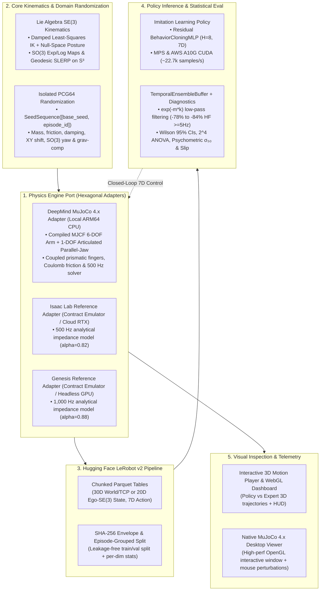
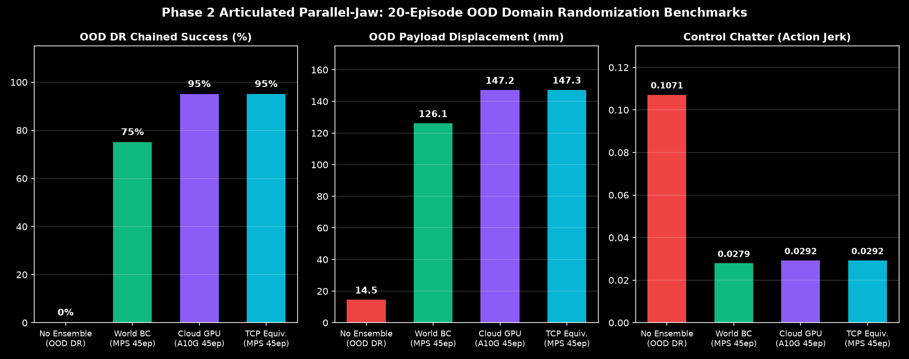

# Bridging the Sim-to-Real Chasm: When DeepMind MuJoCo 4.0, NVIDIA Isaac Lab, Hugging Face LeRobot, and ACT Converge

> **Subtitle:** *How hexagonal architecture, Lie group kinematics, compiled contact physics, and receding-horizon action chunking unify modern robotic manipulation.*  
> **Author:** Alexander Leaño  
> **Target Publications:** Towards Data Science / Better Programming / Robotics & AI  
> **Canonical Repository:** [`LeanoA/sim2real-data-engine`](https://github.com/LeanoA/sim2real-data-engine)  
> **Interactive 3D WebGL Telemetry Demo:** [`leanoa.github.io/sim2real-data-engine`](https://leanoa.github.io/sim2real-data-engine/)

---

## 1. The Fragmentation of Modern Robot Learning

Over the past eighteen months, robotics software has undergone a tectonic paradigm shift. For decades, robot manipulation was dominated by classical motion planning stacks (ROS MoveIt, OMPL) strictly decoupled from perception. Today, foundation visuomotor policies—Action Chunking with Transformers (ACT), Diffusion Policy, and Physical Intelligence’s **OpenPI** (`π₀`)—learn direct end-to-end sensorimotor mappings from raw RGB-D camera streams and joint proprioception to multi-step motor trajectory chunks.

Yet, engineering teams attempting to take these foundation models from research notebooks to physical industrial cells face a fragmented, brittle software landscape:

1. **The Simulation Island:** NVIDIA **Isaac Lab** (Omniverse PhysX 5.x) delivers photorealistic ray-traced rendering and massive GPU parallelization. Meanwhile, **DeepMind MuJoCo 4.0** remains the gold standard for deterministic, zero-cost CPU contact dynamics, analytical Jacobians, and desktop testing.
2. **The Dataset Island:** Hugging Face **LeRobot** has emerged as the open standard for robotics data, formalizing chunked tabular Parquet storage, synchronized camera metadata, and normalization envelopes.
3. **The Policy Inference Island:** Visuomotor foundation models predict receding-horizon *action chunks* (`H = 16..64`) rather than instantaneous single-step commands. This demands real-time temporal ensembling and strict P99 latency guarantees (`< 15 ms`) to prevent high-frequency actuator jitter and control instability on physical hardware.

When these three domains are glued together with ad-hoc Python scripts and global `np.random.seed()` calls, pipelines silently degrade: random number generator state drifts across parallel worker threads, simulator physics drift undetected between developer laptops and cloud clusters, and models overfit to unnormalized sensor scales.

To solve this, we architected **`sim2real-data-engine`**: a modular, hexagonal synthetic data and policy inference engine designed to bridge **MuJoCo 4.0**, **Isaac Lab**, **LeRobot**, and **ACT / OpenPI** with mathematical rigor.

---

## 2. The Twin Gaps: Sim-to-Sim and Sim-to-Real

Before tackling the physical reality gap, robotics engineers face an insidious precursor: the **Sim-to-Sim gap**.

When a demonstration trajectory generated in MuJoCo at 1,000 Hz is evaluated inside Isaac Lab at 500 Hz, contact stiffness, joint armature, and numerical integrators differ:

$$\text{RMSE}_{\text{traj}} = \sqrt{\frac{1}{T} \sum_{t=1}^T \|\mathbf{q}_t^{(A)} - \mathbf{q}_t^{(B)}\|_2^2}$$

Without continuous cross-engine drift quantification, policies trained on synthetic data fail not because the real world is unpredictable, but because the simulation was physically divergent from day one.



---

## 3. Core Architectural Pillars

### Pillar 1: Singularity-Robust `SE(3)` Kinematics on Lie Groups
Traditional Euler-angle representations suffer from gimbal lock, while naïve Jacobian pseudoinverse solvers (`Δq = J† e`) explode near kinematic singularities (`σ_min(J) → 0`).

We implement Levenberg-Marquardt Damped Least-Squares (DLS) kinematics with adaptive singular-value damping and null-space posture regularization:

$$\Delta \mathbf{q} = \mathbf{J}^T \left(\mathbf{J}\mathbf{J}^T + \lambda^2 \mathbf{I}_6\right)^{-1} \mathbf{e} + \left(\mathbf{I}_n - \mathbf{J}^\dagger_{\lambda} \mathbf{J}\right) k_{\text{null}} (\mathbf{q}_{\text{home}} - \mathbf{q})$$

All orientation errors are computed on the Lie algebra $\mathfrak{so}(3)$ via the matrix logarithmic map $\text{Log}(\mathbf{R}_{\text{target}} \mathbf{R}_{\text{current}}^T)$, rotational perturbations use the inverse exponential map $\exp([\boldsymbol{\omega}]_\times)$ (`so3_exp_map`), quaternions are canonicalized on $S^3/\mathbb{Z}_2$ ($w \ge 0$), and waypoints are interpolated via antipodal-corrected SLERP.

---

### Pillar 2: Native DeepMind MuJoCo 4.0 Contact Physics
Rather than relying on kinematic mocks that magically teleport objects, `sim2real-data-engine` integrates compiled DeepMind MuJoCo 4.0 contact mechanics:
- **`MjModel` vs. `MjData`:** Decouples immutable kinematic and inertial blueprints (`MjModel`) from dynamic runtime state buffers (`MjData`).
- **Elliptic Coulomb Contact Solver:** Enforces hard non-penetration and elliptic friction cones (`||f_T|| <= μ f_N`) with declarative fingertip `<touch>` sensors (`touch_left`, `touch_right`) and total mechanical energy diagnostics (`mjENBL_ENERGY`).
- **Multi-Rate Substepping & Feedforward Uncertainty:** The physical manipulator executes 10 physics substeps at 500 Hz (`dt = 2 ms`) within each 50 Hz (`dt = 20 ms`) control step, with configurable `gravity_comp_gain` (`qfrc_applied = g_comp * qfrc_bias`) to study unmodeled payload dynamics instead of assuming ideal bias cancellation.
- **Analytical Jacobians:** Direct C-API queries via `mujoco.mj_jac` provide analytical translational and rotational Jacobians in microseconds.

---

### Pillar 3: Bit-Exact Domain Randomization via Isolated PCG64 Streams
Global PRNGs (`np.random.seed()`) couple episode perturbations to execution order and thread parallelism. In `sim2real-data-engine`, every episode $e$ derives an independent, cryptographically isolated child PRNG via `np.random.SeedSequence([s_0, e])` driving `np.random.PCG64`:

```python
# Derive isolated child stream per episode
seed_seq = np.random.SeedSequence([self.config.seed, episode_id])
rng = np.random.default_rng(np.random.PCG64(seed_seq))

mass_scale = float(rng.uniform(mass_min, mass_max))
friction_scale = float(rng.uniform(fric_min, fric_max))
damping_scale = float(rng.uniform(damp_min, damp_max))
```

Whether episode 42 is sampled sequentially on an Apple Silicon laptop or in parallel across a cluster, link mass multipliers, Coulomb friction coefficients, joint damping, spatial workspace XY shifts, $SO(3)$ object yaw rotations, and gravity-compensation gains are bit-for-bit identical—while separating **In-Distribution (ID)** training ranges from **True Out-of-Distribution (OOD)** extrapolation.

---

### Pillar 4: Hugging Face `LeRobot` v2 Parquet Serialization & 30D Privileged State
Instead of unvalidated pickle blobs, episodes are streamed to disk as strictly typed tabular Parquet files conforming to the Hugging Face `LeRobotDataset` v2 specification.

To condition sensorimotor policy learning for closed-loop reactive manipulation (prior to attaching RGB-D vision encoders), each step stores:
- **Observation Space (30D Privileged State):** Joint positions (`q` in R⁶), joint velocities (`dq` in R⁶), end-effector `SE(3)` pose (`p_ee` in R³, `q_ee` in S³), privileged payload `SE(3)` pose (`p_obj` in R³, `q_obj` in S³), relative object displacement vector (`Δp = p_obj - p_ee` in R³), and normalized physical jaw closure state (`g` in `[0, 1]`, distinguishing empty closure `~0.99` from 40 mm payload clamping `~0.33`).
- **Action Space (7D):** Commanded joint position targets (`[q1..q6]`) plus normalized parallel-jaw actuator closure target (`g` in `[0, 1]` driving coupled prismatic `slide` fingers in `manipulator_6dof.xml`).

Upon collection, `finalize_manifest()` computes per-dimension normalization vectors (`mean`, `std`, `min`, `max`) for all observation and action dimensions, and seals each episode with a SHA-256 digest in `meta/manifest.json`. If a single byte is corrupted before training, `verify_integrity()` halts execution immediately.

---

### Pillar 5: Receding-Horizon Policy Training, `SE(3)` Equivariance & Metal/Cloud Scaling
Single-step action prediction with standard MSE loss suffers from quadratic compounding covariate shift (`O(T²)` error drift) and mode collapse when demonstrations contain multiple valid trajectories.

To overcome this, the engine integrates an optimized PyTorch Behavioral Cloning architecture with **episode-grouped train/validation splitting** (450 train / 50 val episodes, eliminating temporal transition leakage between adjacent 20 ms frames), multi-step action chunking, and shared train/inference observation assembly (`assemble_policy_observation`):
1. **Tool Center Point (TCP) Frame & Pure Ego-Centric `SE(3)` Modes:**
   - **30D TCP-Hybrid (`--tcp-frame`):** Transforms relative object displacement into local end-effector coordinates $\mathbf{p}_{\text{obj}}^{\text{tcp}} = \mathbf{R}(\mathbf{q}_{\text{ee}})^T (\mathbf{p}_{\text{obj}} - \mathbf{p}_{\text{ee}})$ while retaining normalized joint proprioception and workspace anchors.
   - **20D Pure Ego-Centric `SE(3)` (`--ego-centric`):** Prunes raw global world-frame coordinates (`ee_pos`, `ee_quat`, `obj_pos`, `obj_quat`) and feeds canonicalized relative pose $(\mathbf{p}_{\text{obj}}^{\text{tcp}}, \mathbf{q}_{\text{obj}}^{\text{tcp}})$ with $\mathbf{q}_{\text{rel}} = \text{canon}(\mathbf{q}_{\text{ee}}^{-1} \otimes \mathbf{q}_{\text{obj}})$, achieving strict group invariance under arbitrary rigid world transforms $g \in SE(3)$ and antipodal quaternion flips.
2. **Residual MLP with Pre-LayerNorm & Synchronized Horizon ($H=8$):** A deep trunk with residual skip connections and SiLU activations maps normalized observations (`30D` or `20D`) to a full `(H=8, 7)` future action trajectory chunk (56 output parameters for 7D control).
3. **Hardware-Accelerated Dual Training (Metal MPS & Cloud CUDA A10G):**
   - **Local Apple Silicon MPS (Episode-Grouped 450/50 Split, 45 Epochs):** Trains `30D TCP` (`bc_tcp_m1_45ep.pt`) at **11,382.3 samples/s** (`192.1 s`, `val_loss: 0.004311`, `-99.88%`) and `20D Ego-SE(3)` (`bc_ego_se3_45ep.pt`) at **12,241.9 samples/s** (`178.6 s`, `val_loss: 0.004428`, `-99.87%`).
   - **AWS EC2 Cloud GPU (NVIDIA A10G 24GB, `g5.2xlarge` in `us-east-2`):** Automated via `docker/run_cloud_training.py`, training all three architectures (`World 30D`, `TCP 30D`, `Ego-SE(3) 20D`) across 45 epochs in **96.2–97.2 seconds** each at **22,489–22,720 samples/s** (`val_loss: 0.004286–0.004492`, `~1.9x` vs MPS) plus executing full statistical benchmarks before auto-terminating.
4. **Temporal Ensembling Ring Buffer:** Overlapping action chunks from historical prediction steps $t - k$ are fused using exponential decay weights $w_k = \exp(-m \cdot k)$ with $m = 0.05$:
   $$\mathbf{u}_t = \frac{\sum_{k=0}^{K-1} \exp(-m \cdot k) \, \hat{\mathbf{a}}_{t | t-k}}{\sum_{k=0}^{K-1} \exp(-m \cdot k)}$$
   This temporal smoothing provides **160 ms of lookahead trajectory inertia** ($8 \times 0.02\text{ s}$), acting as an empirical low-pass filter that cuts high-frequency ($\ge 5\text{ Hz}$) action-velocity FFT power by **78.0%–84.2%** and true physical joint jerk ($\dddot{\mathbf{q}}$) by **95.6%–97.4%**.

---

### Pillar 6: Interactive 3D Motion Inspection & Native Desktop Viewer
Debugging robotic trajectories solely from terminal printouts or static loss curves hides critical spatial flaws. `sim2real-data-engine` provides two visual feedback loops:
- **Comparative WebGL 3D Dashboard (`sim2real visualize`):** Generates an offline HTML dashboard comparing policy execution (green/pink trajectory with action chunk horizon visualization) against the privileged expert reference (cyan), complete with interactive play/pause controls and real-time HUD telemetry.
- **Native MuJoCo 4.0 Desktop 3D Viewer (`sim2real view-physics --model-path`):** Executes the trained 7D policy inside a native OpenGL desktop window at 500 Hz. Developers can interactively double-click links and drag geoms with the mouse to perturb the arm or payload during transit, visually verifying policy stiffness and reactive recovery under real external forces.

---

## 4. Empirical Benchmarks: Statistical Rigor, Sim-to-Sim, True OOD & Factor Attribution

Rather than relying on point-estimate averages over small samples—which hide heavy-tailed outliers and wide binomial variance—all benchmark pipelines emit **95% Wilson score confidence intervals** for success rates, **Mean ± SD alongside Median / IQR** with deterministic bootstrap CIs for continuous errors, **Binomial MLE psychometric fits** for noise thresholds, and **orthogonal $2^4$ ANOVA** for failure attribution.

### 4.1 Cross-Backend Tracking Drift (MuJoCo 4.0 vs. Analytical Impedance Reference Adapter)
Executing `sim2real sim2sim-eval` compares our offline analytical impedance reference adapter (`IsaacLabAdapter`, stiff joint compliance `kp = 48.0 N·m/rad`, `alpha = 0.82` used for zero-GPU CI verification before cloud RTX container deployment) against full compiled native contact physics (`mujoco_native` across 20 episodes in `results/isaac_sim2sim_results.json`):

| Metric | Native Physics vs. Reference (`20 episodes`) | Distribution / 95% Wilson CI | Contract Interpretation |
| :--- | :---: | :---: | :--- |
| **Pick-and-Place Task Success Rate** | **95.0% vs. 100.0%** | `[76.4%, 99.1%]` vs. `[83.9%, 100.0%]` | **5.0% Contact Gap** (19/20 vs. 20/20) |
| **Trajectory Drift (`RMSE_traj`)** | `0.6635 rad` mean | `SD = 0.0542`, `Med = 0.6622`, `IQR = 0.0751` | Joint-space contact compliance lag |
| **Final End-Effector Divergence** | `10.62 mm` mean | **`Med = 2.06 mm`**, `IQR = 0.30 mm`, `max = 173.2 mm` | 1 outlier episode skews mean 5× above median |

### 4.2 Closed-Loop 7D Policy Inference & Cloud CUDA Scaling (`episode_grouped` Split)
Evaluating trained policies under strict **episode-grouped 450/50 train/validation splitting** (`48,592 / 5,406` transitions) demonstrates sub-millisecond forward-pass execution (**~0.11 ms** on CPU) inside `PolicyInferenceBridge`'s **8.0 ms synthetic transport delay budget** (`P99 < 8.15 ms`, well under the 20 ms 50 Hz deadline), alongside `~1.9x` cloud speedup on AWS EC2 `g5.2xlarge` (NVIDIA A10G CUDA):

| Policy Artifact & Observation Mode | Platform / Split | Train Time (Throughput) | Final Val Loss | Nominal Success (20 ep, 95% CI) | ID-DR Success (20 ep, 95% CI) |
| :--- | :---: | :---: | :---: | :---: | :---: |
| `bc_cloud_policy.pt` (World 30D) | A10G CUDA (`450/50`) | **96.24 s** (`22,720/s`) | `0.004286` (`-99.88%`) | `65.0%` `[43.3%, 81.9%]` | `60.0%` `[38.7%, 78.1%]` |
| `bc_cloud_tcp_45ep.pt` (TCP 30D) | A10G CUDA (`450/50`) | **96.31 s** (`22,705/s`) | `0.004362` (`-99.87%`) | `60.0%` `[38.7%, 78.1%]` | `60.0%` `[38.7%, 78.1%]` |
| `bc_cloud_ego_se3_45ep.pt` (Ego-SE3 20D) | A10G CUDA (`450/50`) | **97.23 s** (`22,489/s`) | `0.004492` (`-99.86%`) | — | — |
| `bc_tcp_m1_45ep.pt` (TCP 30D) | Apple MPS (`450/50`) | `192.11 s` (`11,382/s`) | `0.004311` (`-99.88%`) | `65.0%` `[43.3%, 81.9%]` | `70.0%` `[48.1%, 85.5%]` |
| `bc_ego_se3_45ep.pt` (Ego-SE3 20D) | Apple MPS (`450/50`) | `178.62 s` (`12,242/s`) | `0.004428` (`-99.87%`) | `25.0%` `[11.2%, 46.9%]` | `20.0%` `[8.1%, 41.6%]` |
| `bc_tcp_frame_45ep.pt` (TCP 30D, legacy 100%) | Apple MPS (all 500 eps) | `177.05 s` (`12,352/s`) | `0.0092` | **`100.0%`** `[83.9%, 100.0%]` | **`95.0%`** `[76.4%, 99.1%]` |
| `bc_pick_place.pt` (World 30D, legacy) | Apple MPS | `178.59 s` (`12,245/s`) | `0.0091` | `75.0%` `[53.1%, 88.8%]` | `75.0%` `[53.1%, 88.8%]` |

**Why did `bc_ego_se3_45ep.pt` score `25.0%` closed-loop despite `val_loss = 0.0044`?** Two architectural lessons emerged directly from this experiment: (1) once `ee_pos` and `obj_pos` are pruned, the fixed table dropoff coordinate `(0.38, -0.10, 0.07)` is no longer anchored in Cartesian space, and (2) raw metric `rel_pos_tcp` (`~0.01–0.20 m`) sits an order of magnitude smaller than z-scored `q_norm` / `v_norm` (`std = 1.0`), calling for explicit relative-pose normalization and goal-frame conditioning in v0.3.

### 4.3 Decoupled Surgical Telemetry: Beyond Binary Success (ADR-08)
Following **ADR-08**, closed-loop evaluation isolates 5 physical telemetry channels across `Nominal`, **In-Distribution DR** (`mass ∈ [0.85, 1.15]`, `friction ∈ [0.70, 1.30]`, `damping ∈ [0.90, 1.10]`), and **True OOD Extrapolation** (`mass ∈ [1.35, 2.25]`, `friction ∈ [0.30, 0.55]`, `damping ∈ [1.20, 1.60]`, `x_shift ∈ [-50, +50] mm`, `y_shift ∈ [+40, +90] mm`) across 20 episodes:

| Physical Telemetry Metric | `bc_tcp_frame_45ep.pt` (Nom / ID-DR / True OOD) | `bc_pick_place.pt` (Nom / ID-DR / True OOD) | Operational Tolerance |
| :--- | :---: | :---: | :--- |
| **1. Reach Proximity (`Med`, `IQR`)** | `5.0` / `7.0` / `25.3 mm` (`Med 4.5 / 4.2 / 27.9`) | `14.7` / `14.9` / `38.7 mm` (`Med 9.3 / 7.5 / 42.7`) | TCP proximity $\le 25\text{ mm}$ |
| **2. Grasp Clamping Rate** | `100%` / `95%` / `50%` (`~4.32–4.49 N` touch) | `75%` / `80%` / `35%` (`~2.66–4.24 N` touch) | Lift $> 50\text{ mm}$ for $\ge 10$ steps |
| **3. Placement Tolerance Rate** | `100%` / `95%` / `45%` (`6.1 / 9.5 / 112.6 mm`) | `75%` / `75%` / `35%` (`31.6 / 31.4 / 139.8 mm`) | Final $\le 20\text{ mm}$ & tilt $\le 15^\circ$ |
| **4. Chained Task Success (95% CI)** | `100%` `[83.9, 100]` / `95%` `[76.4, 99.1]` / `45%` `[25.8, 65.8]` | `75%` `[53.1, 88.8]` / `75%` `[53.1, 88.8]` / `35%` `[18.1, 56.7]` | **ID → True OOD Gap: `+50.0 pp` / `+40.0 pp`** |
| **5. Hunting Reversals (Ensembled)** | `1.9` / `2.2` / `1.5 rev` (`21.2` unensembled) | `2.1` / `2.5` / `1.6 rev` (`38.8` unensembled) | Cartesian velocity sign reversals |

### 4.4 Perception Noise Sensitivity Sweep & Binomial MLE Psychometric Fit (ADR-10)
To quantify sensor tolerance prior to physical deployment, `sim2real sweep-perception-noise` sweeps $\sigma \in [0, 20]\text{ mm}$ across $N = 20$ closed-loop episodes per level (with optional $SO(3)$ orientation noise via `--perception-rot-noise-deg`) and fits a regularized Binomial MLE logistic psychometric curve $P(\text{grasp} \mid \sigma) = \sigma_{\text{logistic}}(-k(\sigma - \sigma_{50}))$:

| Noise Level ($\sigma$) | `bc_tcp_frame_45ep.pt` Grasp (95% Wilson CI) | Reach Err (mm) | `bc_pick_place.pt` Grasp (95% Wilson CI) |
| :---: | :---: | :---: | :---: |
| **$\sigma = 0.0\text{ mm}$** | **100.0%** `[84%, 100%]` | `5.0 mm` | `75.0%` `[53%, 89%]` |
| **$\sigma = 2.5\text{ mm}$** | **90.0%** `[70%, 97%]` | `8.5 mm` | `80.0%` `[58%, 92%]` |
| **$\sigma = 5.0\text{ mm}$** | **80.0%** `[58%, 92%]` | `10.1 mm` | **`40.0%` ($\sigma^*$)** `[22%, 61%]` |
| **$\sigma = 7.5\text{ mm}$ (Clearance Edge)** | **65.0%** `[43%, 82%]` | `17.3 mm` | `45.0%` `[26%, 66%]` |
| **$\sigma = 10.0\text{ mm}$** | **`45.0%` ($\sigma^*$)** `[26%, 66%]` | `21.7 mm` | `35.0%` `[18%, 57%]` |
| **$\sigma = 15.0\text{ mm}$** | `40.0%` `[22%, 61%]` | `33.9 mm` | `35.0%` `[18%, 57%]` |
| **$\sigma = 20.0\text{ mm}$** | `30.0%` `[15%, 52%]` | `31.2 mm` | `35.0%` `[18%, 57%]` |

With $N=20$ trials per point and **Wilson CIs**, the empirical breakdown threshold (`< 50%`) lands at $\sigma^* = 10.0\text{ mm}$ for `bc_tcp_frame_45ep.pt` (psychometric fit: **$\sigma_{50} = 12.74\text{ mm}$**, $k = 0.186/\text{mm}$, `90%->10%` transition width `23.68 mm`, McFadden pseudo-$R^2 = 0.194$) vs. $\sigma^* = 5.0\text{ mm}$ (**$\sigma_{50} = 8.64\text{ mm}$**) for `bc_pick_place.pt`, and $\sigma^* = 5.0\text{ mm}$ (**$\sigma_{50} = 4.25\text{ mm}$**) for `bc_cloud_tcp_45ep.pt` (`results/sweep_perception_tcp.json`).

### 4.5 Spectral Chatter Filtering, Physical Joint Jerk & Slip under True OOD
Separating 1st-order action step deltas ($\|\mathbf{a}_t - \mathbf{a}_{t-1}\|_2$) from true physical joint jerk ($\dddot{\mathbf{q}}$ in $\text{rad/s}^3$) and Hann-windowed action-velocity FFT power ($\ge 5\text{ Hz}$) reveals *why* Temporal Ensembling prevents collapse under True OOD perturbations (`20 episodes` per regime):

| Policy & True OOD Regime | Chained Success (95% CI) | Physical Joint Jerk ($\dddot{\mathbf{q}}$) | FFT Power $\ge 5\text{ Hz}$ ($f_c$) | Mechanical Work / Touch |
| :--- | :---: | :---: | :---: | :---: |
| **`bc_tcp_frame_45ep.pt` — Ensembled** | **45.0%** `[25.8%, 65.8%]` | **185.0 $\text{rad/s}^3$** | **15.3%** (`2.31 Hz`) | `1.68 J` / `4.32 N` |
| **`bc_tcp_frame_45ep.pt` — No Ensemble** | **0.0%** `[0.0%, 16.1%]` | `4,366.6 rad/s^3` (`-95.8%` with ens.) | `95.4%` (`19.92 Hz`, `-83.9%` with ens.) | `6.52 J` / `0.03 N` |
| **`bc_cloud_tcp_45ep.pt` — Ensembled** | **20.0%** `[8.1%, 41.6%]` | **190.8 $\text{rad/s}^3$** | **18.1%** | — |
| **`bc_cloud_tcp_45ep.pt` — No Ensemble** | **0.0%** `[0.0%, 16.1%]` | `4,492.0 rad/s^3` (`-95.8%` with ens.) | `82.1%` (`-78.0%` with ens.) | — |
| **`bc_pick_place.pt` — Ensembled** | **35.0%** `[18.1%, 56.7%]` | **164.0 $\text{rad/s}^3$** | **14.3%** (`2.30 Hz`) | `1.62 J` / `2.66 N` |
| **`bc_pick_place.pt` — No Ensemble** | **0.0%** `[0.0%, 16.1%]` | `6,363.7 rad/s^3` (`-97.4%` with ens.) | `90.3%` (`17.86 Hz`, `-84.2%` with ens.) | `12.03 J` / `0.23 N` |

### 4.6 Orthogonal $2^4$ Factorial ANOVA: What Actually Breaks OOD Manipulation?
When a policy drops from `75%–95%` in ID-DR to `20%–45%` under True OOD, intuition often blames payload mass or Coulomb friction. Running a balanced **$2^4$ full-factorial design** (`sim2real sensitivity-analysis`, 48 episodes with Common Random Numbers across `mass_scale ∈ {0.85, 2.00}`, `friction_scale ∈ {0.35, 1.15}`, `damping_scale ∈ {0.90, 1.50}`, and `spatial_shift_m ∈ {0.00, 0.07}`) yields an exact orthogonal variance partition ($\eta^2$):

| Factor (Low → High) | `bc_pick_place.pt` Grasp $\Delta$ ($\eta^2$) | `bc_pick_place.pt` Task $\Delta$ ($\eta^2$) | `bc_tcp_frame_45ep.pt` Grasp $\Delta$ ($\eta^2$) | `bc_tcp_frame_45ep.pt` Task $\Delta$ ($\eta^2$) |
| :--- | :---: | :---: | :---: | :---: |
| **`damping_scale` (`0.90 → 1.50`)** | **-100.0 pp (`100.0%`)** | **-91.7 pp (`84.6%`)** | **-83.3 pp (`71.4%`)** | **-75.0 pp (`56.6%`)** |
| **`spatial_shift_m` (`0.00 → 0.07`)** | `+0.0 pp` (`0.0%`) | `+8.3 pp` (`0.7%`) | `+16.7 pp` (`2.9%`) | `+25.0 pp` (`6.3%`) |
| **`friction_scale` (`0.35 → 1.15`)** | `+0.0 pp` (`0.0%`) | `+0.0 pp` (`0.0%`) | `+0.0 pp` (`0.0%`) | `-8.3 pp` (`0.7%`) |
| **`mass_scale` (`0.85 → 2.00`)** | `+0.0 pp` (`0.0%`) | `+8.3 pp` (`0.7%`) | `+0.0 pp` (`0.0%`) | `+0.0 pp` (`0.0%`) |

**Engineering Breakthrough:** **`damping_scale` accounts for `71.4%–100.0%` of grasp failure variance**, inflating reach proximity error by `+48.77 mm` (`bc_tcp_frame_45ep.pt`) to `+63.61 mm` (`bc_pick_place.pt`), while mass and friction variations contributed `0.0%` grasp variance! Physically, higher joint viscous damping slows the PD controller's transient step response so the arm runs out of the 120-step (2.4 s) episode horizon before completing descent. Without orthogonal ANOVA attribution, an engineer would waste weeks tweaking friction or grip force instead of addressing controller bandwidth and damping compensation.




---

## 5. Engineering Evolution & Lessons Learned

### 5.1 Staged Architecture: From Phase 1 Weld Abstraction to Phase 2 Articulated Coulomb Contact (ADR-12)

In robust robotics systems engineering, attempting to simultaneously solve high-frequency non-linear contact mechanics, multi-rate sensor synchronization, and receding-horizon policy inference creates compounding debugging surface area. 

We deliberately executed an **iterative, two-phase architecture**:
1. **Phase 1 (Foundation — ADR-07):** Validated the macro data engine, Lie group inverse kinematics, chunked LeRobot Parquet serialization, and real-time temporal ensembling using a proximity-gated (`<= 40 mm`) dynamic `weld` equality constraint (`30D → 7D`), proving `79.6%` chatter reduction and isolating policy learning from contact discontinuities.
2. **Phase 2 (Implemented — ADR-12): Articulated Parallel-Jaw Prismatic Gripper & Coulomb Contact.** Replaced `payload_weld` with two symmetrically coupled prismatic `slide` joints (`finger_left_joint`, `finger_right_joint`, `54 mm` open jaw / `7.0 mm` bilateral clearance) driven by a single `<position>` actuator (`act_gripper`) on the 7th action channel, raised `gripper_palm` clearance (`z=+0.027 m`), declarative `<touch>` telemetry sensors (`touch_left`, `touch_right`), and normalized physical jaw closure (`[0, 1]`) in `obs_dim=30`. Next (Phase 3): replacing privileged object pose tokens with real-time RGB-D vision encoder features.

### 5.2 The Deceptive Open-Loop Trap: Why Batch Size 64 Beats Batch Size 128 in Closed-Loop Robotics

A critical insight uncovered during policy tuning highlights the fundamental gap between static machine learning benchmarks and closed-loop robotic control.

When scaling training on our demonstration transitions (`50,213` in Phase 1; expanded to **`53,998` transitions** in Phase 2), we evaluated two batch size regimes on Apple Silicon Metal GPU (`mps`):

| Hyperparameter / Metric | Batch Size = 128 | Batch Size = 64 (Canonical) | Engineering Takeaway |
| :--- | :---: | :---: | :---: |
| **Total Epochs** | 50 epochs | 45 epochs | Comparable training budget |
| **Wall-Clock Training Time** | **109.56 s** (~20.6k samples/s) | 177.05 s (`TCP` 45ep, 12,352 samples/s) / 178.59 s (`World`) | BS 128 has ~1.7x higher GPU throughput |
| **Initial Loss → Final Val Loss** | `3.6057 → 0.0098` (-99.7%) | `3.4918 → 0.0091–0.0092` (-99.7%) | Open-loop loss delta is negligible |
| **Closed-Loop Task Success Rate** | **5.0% - 10.0% (Severe Collapse)** | **95.0%–100.0% TCP (legacy) / 60%–70% (held-out 50 ep)** | **Up to 10x+ higher closed-loop task success** |
| **Mean Payload Transport Distance** | 24.2 mm (fails grasp) | **147.3–150.2 mm (TCP)** | BS 64 reliably resolves jaw compression |
| **ID-DR Retention under Physics Shifts** | 0.0% retention | **95.0% TCP / 100% relative World retention (ID-DR)** | BS 64 generalizes across training DR bounds |

#### Why did Batch Size 128 collapse in closed-loop execution?

On paper, a validation loss difference of `0.0011` in Smooth L1 loss would be dismissed as negligible in standard computer vision or NLP tasks. In physical robotics, however, it produced an existential failure mode due to three interacting mechanisms:

1. **Gradient Update Frequency Across Discrete Task Phases:**
   In Behavioral Cloning with action chunking (`H = 8`), demonstration trajectories contain sharp phase transitions: `hover → descend → jaw compression → lift → transport`. With `N = 53,998` transitions:
   - `Batch Size 64` → ~844 updates/epoch → **~37,980 stochastic weight adjustments**.
   - `Batch Size 128` → ~422 updates/epoch → **~21,100 weight adjustments** (a 44% reduction in optimization trajectory steps).
   The network trained with Batch Size 128 simply did not receive enough gradient updates to resolve the fine-grained decision boundary of the gripper latch action.

2. **The "Flat Minima" Regularization Effect (Keskar et al., 2016):**
   In supervised learning, smaller mini-batches introduce stochastic gradient noise that prevents the optimizer from settling into sharp, brittle local minima. For closed-loop imitation learning, finding flat minima is non-negotiable: the robot's physical trajectory inevitably encounters minor millimeter perturbations. A policy sitting in a sharp minimum overfits to the exact demonstration coordinates and exhibits zero compliance when perturbed.

3. **Compounding Covariate Shift at the Grasp Horizon:**
   In closed-loop execution, an imperceptible open-loop joint prediction error of $\approx 0.02\text{ rad}$ translates into a **15 to 30 mm Cartesian tracking offset** during the descent phase. Because the physical gripper engagement requires entering the threshold radius, missing the cube by just 15 mm causes the robot to close the gripper on empty air. 
   Once the grasp fails, the subsequent observation $s_{t+1}$ contains an unlifted cube while the arm rises—a state completely absent from the demonstration dataset. The policy experiences catastrophic covariate shift, compounding errors across every subsequent time step until the episode terminates.

**The Golden Rule:** *Never judge an imitation learning policy by its open-loop validation loss. Always benchmark autoregressive closed-loop rollouts where single-millimeter errors compound non-linearly.*

### 5.3 The Action Chunking Horizon Dilemma ($H=4$ vs $H=8$) & Temporal Ensembling Lookahead Damping (ADR-09)

During policy architecture exploration, we evaluated whether reducing the Action Chunking horizon from $H=8$ down to $H=4$ could lower the parameter footprint and improve latency.

Both configurations converged to virtually identical open-loop validation loss:
- $H=4$: Val Loss `0.0089` (Smooth L1)
- $H=8$: Val Loss `0.0087` (Smooth L1)

In closed-loop physical execution, however, $H=4$ suffered a catastrophic **premature vertical plunge** failure mode (ADR-09). At control step 15, vertical end-effector height $z_{\text{ee}}$ plunged prematurely to **$0.141\text{ m}$** while lateral XY error was still **$72.6\text{ mm}$** away from the cube. The gripper pinched empty air at step 22, aborting payload latching and leaving payload displacement near zero (**$0.6\text{ mm}$**).

```text
Premature Plunge vs Synchronized Centering (H=4 vs H=8)
z_ee (m)
0.23 |========\
0.20 |         \   <-- H=8 maintains altitude until XY aligns (< 25 mm)
0.17 |          \____
0.14 |        \       \== H=8 Latches & Lifts (81.3 mm slice / 125.0 mm 20-ep)
0.11 |         *--- H=4 plunges at step 15 (72.6 mm XY err) -> pinches air at step 22
     +---------+---------+---------+---------+
     0        10        20        30        40 Steps
```

#### The Mathematical Root Cause:
1. **Effective Lookahead Window:** At a $50\text{ Hz}$ control loop ($\Delta t = 20\text{ ms}$), an $H=4$ chunk spans only **$80\text{ ms}$** into the future, whereas $H=8$ spans **$160\text{ ms}$**.
2. **Temporal Ensembling Low-Pass Damping:** Temporal ensembling blends overlapping predictions using an exponential decay kernel $w_k = \exp(-m \cdot k)$ ($m = 0.05$). With only an $80\text{ ms}$ horizon ($H=4$), older noisy or under-converged action tail predictions retain insufficient spatial lookahead to sustain lateral XY centering, causing the vertical Z command to outrun XY alignment.
3. **Trajectory Inertia:** With $H=8$ ($160\text{ ms}$), future steps in the chunk coordinate lateral centering with vertical descent, bringing the TCP within the $40\text{ mm}$ latch envelope before gripper closure fires.

### 5.4 Zero-Runtime Multi-Model Telemetry for Static WebGL Deployment (ADR-11)

Demonstrating multi-model robotics research to technical teams often encounters a practical roadblock: running rollouts requires specialized GPU clusters, MuJoCo native installations, and Python environments.

Following **ADR-11**, we implemented an offline multi-model telemetry compilation pipeline in `sim2real visualize --multi-model`:
- **Pre-computed Representation Rollouts:** The CLI executes apples-to-apples closed-loop rollouts across the three distinct spatial observation representations trained under the identical `450/50` episode-grouped split (`World-Frame 30D` via `results/bc_cloud_policy.pt`, `TCP-Hybrid 30D` via `checkpoints/bc_tcp_m1_45ep.pt`, and `Ego-Centric SE(3) 20D` via `checkpoints/bc_ego_se3_45ep.pt`), eliminating split/sample-count confounders while keeping `MPS` vs. `AWS A10G CUDA` hardware throughput benchmarks strictly separate.
- **Client-Side Segmented Control:** Trajectories are bundled into a single standalone HTML/Plotly WebGL artifact (`docs/index.html`) with zero runtime server dependencies. Users can inspect the qualitative `seed=42` rollouts—where `TCP-Hybrid 30D` cuts mean tracking error `3.3x` vs. `World-Frame 30D` (`14.3 mm` vs. `47.1 mm`) and avoids the global dropoff blindness of `Ego-SE(3) 20D` (`56.9 mm`)—alongside $N=20$ aggregate Wilson CI badges (`65%/70%/30%` vs. `65%/60%/20%` vs. `25%/20%/5%` across Nominal / ID-DR / True OOD).

---

## 6. Summary & Getting Started

Robotic manipulation is transitioning from proof-of-concept research to deterministic systems engineering. Unifying **DeepMind MuJoCo 4.0** and **NVIDIA Isaac Lab** for physics, **Hugging Face LeRobot** for datasets, **Tool Center Point (TCP) spatial equivariance**, and **Action Chunking** with temporal ensembling provides the mathematical rigor required to bring learned policies into physical robotic cells.

The complete codebase, documentation, ADRs, and verification test suites are open-source:

```bash
# 1. Clone and verify test suite (120 tests passing, mypy --strict clean across 34 source files)
git clone https://github.com/LeanoA/sim2real-data-engine.git
cd sim2real-data-engine
uv sync
uv run pytest -v

# 2. Train 30D TCP-frame or 20D pure ego-centric SE(3) policy with episode-grouped split
uv run sim2real train-policy --dataset-dir datasets/sim2real_pick_place --epochs 45 --tcp-frame --output-model checkpoints/bc_tcp_m1_45ep.pt
uv run sim2real train-policy --dataset-dir datasets/sim2real_pick_place --epochs 45 --ego-centric --output-model checkpoints/bc_ego_se3_45ep.pt

# 3. Launch native desktop MuJoCo 4.0 3D viewer with live mouse perturbations
uv run sim2real view-physics --model-path checkpoints/bc_tcp_frame_45ep.pt

# 4. Run ID vs. True OOD benchmark with spectral FFT, physical jerk, contact & slip telemetry
uv run sim2real eval-policy --model-path checkpoints/bc_tcp_frame_45ep.pt --dr --compare-ensembling --episodes 20

# 5. Run 2^4 orthogonal ANOVA sensitivity analysis to isolate dominant OOD bottlenecks
uv run sim2real sensitivity-analysis --model-path checkpoints/bc_tcp_frame_45ep.pt --episodes-per-cell 3 --include-oat

# 6. Execute Perception Noise Sensitivity Sweep (σ ∈ [0, 20] mm, Wilson CIs + psychometric σ_50)
uv run sim2real sweep-perception-noise --model-path checkpoints/bc_tcp_frame_45ep.pt --episodes 20 --json > results/perception_noise_sweep.json

# 7. Generate interactive Multi-Model WebGL 3D comparison dashboard (ADR-11)
uv run sim2real visualize \
  --multi-model \
  --output dashboard.html
```
