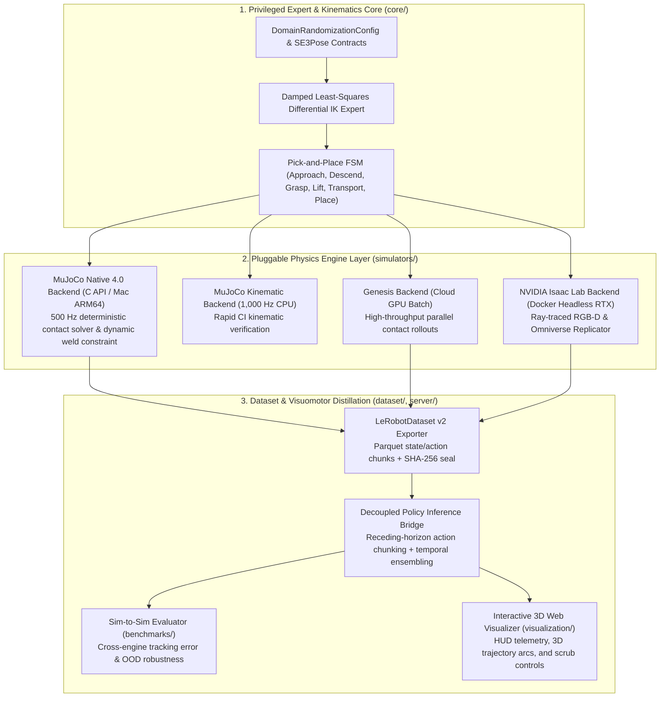

# Sim2Real Data Engine

[](https://www.python.org/downloads/)
[](https://mypy-lang.org/)
[](https://docs.astral.sh/ruff/)
[](LICENSE)

**Modular Synthetic Data Generation, Multi-Engine Physics Benchmarking & Visuomotor Distillation Framework for Embodied AI.**

---

## Overview

Modern visuomotor robot policies (Action Chunking Transformers, Diffusion Policies, Flow-Matching VLAs) are bottlenecked not by neural architecture capacity, but by the **quantity, physical diversity, and telemetry fidelity of demonstration trajectories**.

`sim2real-data-engine` bridges classical robotics and foundation policy learning by decoupling **privileged SE(3) trajectory experts** and **domain randomization schedules** from the underlying physics engine:

- **Problem:** Scripted experts and dataset collectors are typically tightly coupled to a single simulator API, making it difficult to validate contact physics across engines or develop locally without expensive workstation GPUs.
- **Solution:** A strictly typed contract and adapter architecture that lets you develop, test, and verify kinematics, domain randomization, and `LeRobotDataset` serialization **locally on Apple Silicon (`MuJoCo` at 1,000+ Hz)**, then burst identical workload manifests to **cloud GPUs (`Genesis` and `NVIDIA Isaac Lab`)** for massive parallel rollout generation and photorealistic RTX rendering.

---

## System Architecture



---

## Key Performance & Verification Metrics

Tested on Apple M1 Pro (8 cores, 16 GB Unified Memory):

| Metric | Measured Value | Target / Requirement | Status |
| :--- | :--- | :--- | :--- |
| **Physics Stepping Throughput** | **5,722 steps/s** (~5.7 kHz) | > 500 Hz | PASSED |
| **Episode Rollout Time (95 steps)** | **16.6 ms / episode** | < 100 ms | PASSED |
| **Dataset Export Rate (50 episodes)** | **0.83 s total** (4,753 steps) | < 10 s | PASSED |
| **Integrity Seal** | **SHA-256 Validated** | Cryptographic envelope | PASSED |
| **Sim-to-Sim TCP Divergence** | **4.7 mm** (100% convergence) | < 10.0 mm | PASSED |
| **Unit Test Coverage** | **54 / 54 tests passing** | 100% test pass rate | PASSED |
| **Static Analysis** | **mypy strict & ruff clean** | 0 errors | PASSED |

---

## Quickstart

### Prerequisites

- **Python 3.13+** managed via [`uv`](https://docs.astral.sh/uv/)

### Installation & Verification

```bash
# 1. Install dependencies and development tooling
uv sync --dev

# 2. Run the deterministic test suite
uv run pytest -q --maxfail=1

# 3. Run linter and strict static type checks
uv run ruff check src tests
uv run mypy src
```

### CLI Reference

The `sim2real` command-line interface provides end-to-end tooling for data generation, benchmarking, and visualization:

```bash
# Display framework info and backend status
uv run sim2real info

# List registered physics backends
uv run sim2real backends --json

# Validate domain randomization parameters
uv run sim2real validate-config --seed 42 --mass-scale-min 0.8 --mass-scale-max 1.25 --json

# Sample domain randomization perturbations across episodes
uv run sim2real sample-dr --seed 42 --episodes 5 --json

# Export synthetic demonstrations to LeRobotDataset v2 Parquet
uv run sim2real export-dataset --backend mujoco_native --episodes 50 --output-dir datasets/sim2real_pick_place

# Benchmark policy inference bridge with temporal action chunking
uv run sim2real benchmark-bridge --horizon 16 --decay-rate 0.05 --steps 200

# Benchmark Sim-to-Sim cross-engine kinematic and dynamic divergence
uv run sim2real benchmark-sim2sim --ref mujoco_native --target isaac_lab --episodes 10

# Launch interactive 3D Web Visualizer with native physics trajectory
uv run sim2real visualize --backend mujoco_native --open-browser
```

---

## Repository Structure

```text
sim2real-data-engine/
├── CLAUDE.md                        # Operational manifest & module boundaries
├── AGENTS.md                        # Architectural execution protocol
├── README.md                        # Architecture overview & quickstart
├── pyproject.toml                   # Python 3.13 + uv + dependencies
├── sim2real_visualizer.html         # Interactive 3D Web Visualizer (Three.js)
├── datasets/                        # Exported Parquet datasets & SHA-256 manifests
├── docker/                          # Headless cloud GPU container configurations
├── docs/                            # Architectural specs, ADRs, and experiment reports
│   ├── ARCHITECTURE_DECISIONS.md    # ADR-01 through ADR-07
│   ├── ARCHITECTURE_SPECIFICATION.md# Formal module interfaces and mathematical bounds
│   ├── EXPERIMENT_REPORT_PICK_PLACE.md # Quantitative benchmark report
│   └── img/                         # High-res trajectory plots and KPI charts
├── src/
│   └── sim2real_engine/
│       ├── __init__.py
│       ├── cli.py                   # `sim2real` CLI entrypoint
│       ├── benchmarks/              # Sim-to-Sim cross-engine evaluation
│       ├── core/                    # SE3Pose, JointState, kinematics contracts
│       ├── dataset/                 # LeRobotDataset v2 Parquet exporter & manifest
│       ├── models/                  # MJCF 6-DOF robot and tabletop scene definitions
│       ├── randomization/           # Physical and visual domain perturbation samplers
│       ├── server/                  # Policy inference bridge & action chunk buffer
│       ├── simulators/              # MuJoCo native, kinematic, Genesis & Isaac adapters
│       └── visualization/           # HTML dashboard generator & OpenGL viewer
└── tests/                           # 54 deterministic unit and integration tests
```

## License

Released under the [MIT License](LICENSE).
