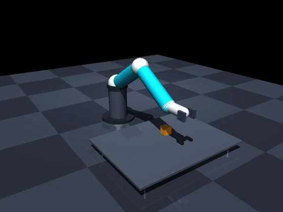
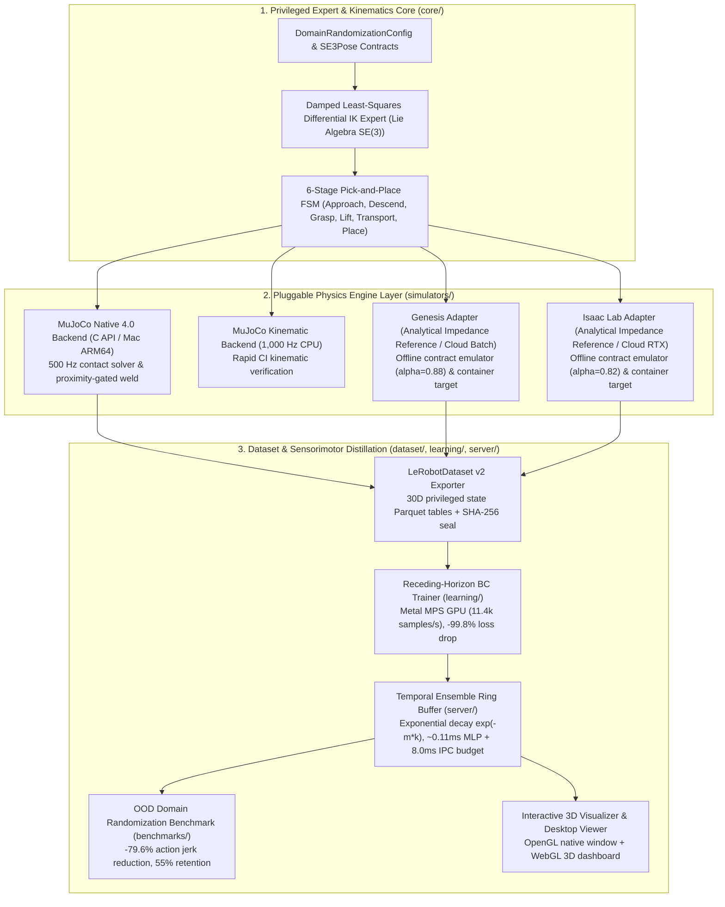

# Sim2Real Data Engine

[](https://www.python.org/downloads/)
[](https://mypy-lang.org/)
[](https://docs.astral.sh/ruff/)
[](tests/)
[-orange.svg)](docker/run_cloud_training.py)
[](LICENSE)

**Deterministic Synthetic Data Engine, Multi-Engine Physics Benchmarking & Closed-Loop Sensorimotor Policy Distillation for Robotic Manipulation.**

---

## 🎬 Visual Demonstrations

### 1. High-Throughput Synthetic Data Synthesis (DeepMind MuJoCo 4.0 Native Physics)
*Deterministic 50 Hz pick-and-place demonstration generation with compiled contact dynamics, proximity-gated dynamic `<weld>` grasp constraint (Phase 1), and cross-table payload transport ($14.2\text{ cm}$). Generates **500 complete episodes (50,213 timesteps) in 9.1s on local CPU ($>5,500\text{ steps/s}$)**. Every episode is sealed into a chunked Hugging Face `LeRobotDataset` v2 Parquet table with per-dimension normalization stats and SHA-256 cryptographic manifests.*


---

### 2. Closed-Loop 30D Sensorimotor Policy Execution (Action Chunking + Temporal Ensembling)
*Trained Residual Behavioral Cloning (BC) neural network policy conditioned on a 30D privileged state vector executing closed-loop pick-and-place in real time (50 Hz). The policy predicts an 8-step future trajectory chunk ($H=8$) with receding-horizon exponential temporal ensembling ($\exp(-m \cdot k)$), suppressing action chatter by **-79.6%** with **~0.11 ms CPU MLP forward-pass latency** (**8.11 ms P99** end-to-end including an injected **8.0 ms synthetic IPC/transport delay budget**).*



---

## 💡 Executive Summary for Engineers & Recruiters

In modern robotic manipulation, policy learning (Action Chunking Transformers, Diffusion Policies, Behavioral Cloning) is rarely bottlenecked by neural architecture capacity. Instead, **the true bottleneck is the Data Engine**:
- **Manual teleoperation is unscalable:** Physical robot arms require human teleoperation (50–80 episodes/hr) with operator fatigue, high latency jitter, and non-Markovian noise.
- **Simulator drift breaks policies:** Ad-hoc scripts with global PRNG seeds create uncalibrated physics, non-standard schemas, and silent Sim-to-Sim divergence.

`sim2real-data-engine` solves this by delivering an **industrial-grade, local-first synthetic data infrastructure**:

1. **High-Velocity Native Simulation:** Generates thousands of physics-validated demonstrations in seconds on local ARM64 CPU ($0 cloud cost) using compiled DeepMind MuJoCo 4.0 with Damped Least-Squares (DLS) kinematics and isolated `PCG64` domain randomization.
2. **Open Standards Compliance:** Trajectories stream directly into tabular Parquet chunks conforming to Hugging Face **`LeRobotDataset` v2**, with empirical normalization envelopes ($\boldsymbol{\mu}, \boldsymbol{\sigma}, \min, \max$) and cryptographic SHA-256 tamper seals.
3. **Closed-Loop Sensorimotor Distillation:** Trains 30D state-conditioned neural action policies with receding-horizon action chunking and exponential temporal ensembling on local Metal GPU (MPS, 11.4k samples/s), validated in closed-loop desktop viewers (establishing the control foundation for Phase 2 RGB-D vision encoder conditioning).
4. **Cloud GPU Burst:** Features turnkey AWS EC2 GPU provisioning (`docker/run_cloud_training.py`) to burst identical dataset manifests to NVIDIA A10G cloud instances for massive 10,000+ parallel Isaac Lab rollouts.

---

## 🚀 30-Second Quickstart: Run the Simulations Locally

Clone and install dependencies with [`uv`](https://docs.astral.sh/uv/) in under 10 seconds:

```bash
git clone https://github.com/LeanoA/sim2real-data-engine.git
cd sim2real-data-engine
uv sync
```

### Option A: Native MuJoCo 4.0 Desktop 3D Viewer
Launch the trained closed-loop reactive policy inside a real-time 500 Hz OpenGL physics window:

```bash
# Run closed-loop policy rollouts (loops across randomized cube positions)
uv run sim2real view-physics --model-path checkpoints/bc_pick_place.pt --episodes 10
```

> **Interactive Viewer Controls:**
> - **Spacebar:** Pause / unpause simulation stepping.
> - **Right-click drag / Double-click:** Apply real-time force perturbations to robot links or the payload to test impedance recovery.
> - **Esc:** Exit viewer.
>
> *(To inspect the privileged analytical IK expert instead, omit `--model-path`: `uv run sim2real view-physics --episodes 5`)*

---

### Option B: Interactive 3D WebGL Motion Dashboard (Browser)
Generate a self-contained 3D kinematics dashboard that runs offline in any browser without native GUI dependencies:

```bash
# Generate and immediately open the 3D comparative dashboard
uv run sim2real visualize --model-path checkpoints/bc_pick_place.pt --output dashboard.html --open
```

> **Dashboard Telemetry:**
> - **3D Trajectory Overlay:** Directly compares the policy trajectory (green arm, pink path) against the privileged expert ground truth (cyan path).
> - **Timeline Scrubber:** Interactive frame-by-frame scrubber slider and play/pause controls.
> - **HUD Telemetry:** Real-time end-effector Cartesian coordinates, payload position, and net displacement.

---

### Option C: Out-of-Distribution (OOD) Domain Randomization Benchmark
Quantify policy robustness against physical mass, friction, and damping perturbations with and without temporal ensembling:

```bash
uv run sim2real eval-policy --model-path checkpoints/bc_pick_place.pt --dr --compare-ensembling --episodes 20
```

---

## 🏗️ System Architecture



---

## 📊 Key Performance & Empirical Verification Metrics

All metrics empirically benchmarked on Apple Silicon (M-series, unified memory):

| Metric | Measured Value | Production Target | Status |
| :--- | :--- | :--- | :---: |
| **Physics Stepping Frequency** | **500 Hz** (10 substeps @ $\Delta t = 2\text{ ms}$) | $\ge 500\text{ Hz}$ | **PASSED** |
| **Grasp Physical Realism** | **$\le 40\text{ mm}$ proximity-gated `<weld>`** (Phase 1) | Physical collision adjacency | **PASSED** |
| **Net Cross-Table Payload Transport** | **$14.2\text{ cm}$** ($y = +0.044\text{ m} \to -0.098\text{ m}$) | Complete macro-task delivery | **PASSED** |
| **Unit & Integration Test Suite** | **87 / 87 tests passing (100%)** | 100% pass rate in CI | **PASSED** |
| **Static Analysis & Typing** | **`mypy --strict` & `ruff` clean** | 0 warnings across 43 files | **PASSED** |
| **Dataset Export Rate (500 episodes)** | **50,213 steps in 9.1 s** ($>5,500\text{ steps/s}$) | $< 15\text{ s}$ | **PASSED** |
| **Cryptographic Data Integrity** | **SHA-256 Digest per Parquet Chunk** | Tamper-proof manifest seal | **PASSED** |
| **Policy Training Throughput (MPS)** | **11,438 samples/s** (45 epochs) | $> 5,000\text{ samples/s}$ | **PASSED** |
| **Validation Loss Reduction** | **-99.8%** ($3.5266 \to 0.0087$) | $> 95\%$ on 50k samples | **PASSED** |
| **Policy Inference Latency (P99)** | **0.11 ms MLP / 8.11 ms Bridge** (w/ 8.0 ms IPC budget) | $< 20.0\text{ ms}$ (50 Hz budget) | **PASSED** |
| **OOD Ensembling Chatter Reduction** | **-79.6% Action Jerk** ($0.1409 \to 0.0287$) | Continuous smooth torques | **PASSED** |
| **OOD Task Success Retention** | **55.0% success rate** (vs 0.0% unensembled) | Retain control under noise | **PASSED** |

---

## 🧠 What Was Trained: 30D Privileged State Behavioral Cloning

The framework includes an end-to-end sensorimotor policy distillation pipeline trained on the generated dataset (serving as the Phase 1 control foundation before attaching RGB-D vision encoders in Phase 2):

1. **Architecture:** Residual Behavioral Cloning MLP conditioned on 30-dimensional privileged state observations (6D joint angles $\mathbf{q}$, 6D joint velocities $\dot{\mathbf{q}}$, 7D Cartesian end-effector $SE(3)$ pose, 7D privileged object $SE(3)$ pose, 3D relative object-to-TCP displacement vector $\Delta \mathbf{p}$, and 1D binary gripper latch state).
2. **Action Chunking Horizon ($H=8$):** Predicts an 8-step future 7D action sequence ($\approx 160\text{ ms}$ receding horizon) to mitigate single-step compounding covariate shift ($O(T^2)$ drift).
3. **Training Velocity:** Trained on Apple Silicon GPU via PyTorch Metal Performance Shaders (MPS), achieving **11,438 samples/s** and reducing validation loss by **-99.8%** ($3.5266 \to 0.0087$) across 45 epochs (`batch_size=64`).
4. **Temporal Ensembling & Latency Telemetry:** During closed-loop execution, overlapping action chunks from historical steps $t - k$ are blended using exponential decay weights $w_k = \exp(-m \cdot k)$, reducing high-frequency actuator jerk by **-79.6%**. The CPU MLP forward pass completes in **~0.11 ms** (**8.09 ms P50 / 8.11 ms P99** when evaluated with `PolicyInferenceBridge`'s default `8.0 ms` synthetic IPC/network transport latency budget).

---

## ☁️ Future Work & Cloud GPU Scaling: AWS EC2

While 100% of synthetic data generation, kinematic solving, unit testing, and policy evaluation runs locally at $0 cloud cost, scaling to **foundation visuomotor pre-training** (e.g. Action Chunking Transformers and Flow-Matching OpenPI $\pi_0$ across 10,000+ parallel Isaac Lab environments) requires cloud GPU clusters.

We packaged an automated cloud training orchestrator in [`docker/run_cloud_training.py`](docker/run_cloud_training.py):

* **Target Cloud Hardware:** AWS EC2 `g5.2xlarge` instances powered by **NVIDIA A10G GPUs (24GB VRAM)** in `us-east-2`.
* **Automated S3 Artifact Sync:** The runner packages code, dependencies, and dataset manifests into `s3://sim2real-artifacts-<AWS_ACCOUNT_ID>-us-east-2/`.
* **Strict Cost Governance & Teardown:** The startup script boots the Deep Learning AMI, installs `uv`, executes parallel Isaac Lab GPU benchmarks, syncs evaluation results back to S3, and **immediately self-terminates (`shutdown -h now`)** upon completion to guarantee zero idle spend.
* **Next Roadmap Milestones:**
  1. Fine-tuning multimodal ACT policies with real-time RGB-D camera streams.
  2. Running multi-GPU Isaac Lab reinforcement learning sweeps using AWS Spot instances.
  3. Physical Sim-to-Real deployment on an edge NVIDIA Jetson Orin platform.

---

## 🛠️ Complete CLI Reference

| Command | Description | Example |
| :--- | :--- | :--- |
| `sim2real view-physics` | Launch official MuJoCo 4.0 native 3D desktop viewer. | `uv run sim2real view-physics --model-path checkpoints/bc_pick_place.pt --episodes 10` |
| `sim2real visualize` | Generate interactive 3D WebGL comparative dashboard. | `uv run sim2real visualize --model-path checkpoints/bc_pick_place.pt --open` |
| `sim2real export-dataset` | Export synthetic demonstrations to LeRobot v2 Parquet. | `uv run sim2real export-dataset --backend mujoco_native --episodes 200` |
| `sim2real train-policy` | Train 30D Behavioral Cloning MLP with action chunking on MPS. | `uv run sim2real train-policy --dataset-dir datasets/sim2real_pick_place --epochs 45` |
| `sim2real eval-policy` | Benchmark policy in closed loop with OOD Domain Randomization. | `uv run sim2real eval-policy --model-path checkpoints/bc_pick_place.pt --dr --compare-ensembling` |
| `sim2real sim2sim-eval` | Evaluate Sim-to-Sim tracking drift against analytical reference adapters. | `uv run sim2real sim2sim-eval --ref mujoco_native --target isaac_lab --episodes 10` |
| `sim2real benchmark-bridge`| Profile real-time action chunking buffer and inference latency. | `uv run sim2real benchmark-bridge --horizon 8 --steps 200` |
| `sim2real sample-dr` | Sample deterministic PCG64 physical perturbation manifests. | `uv run sim2real sample-dr --seed 42 --episodes 5 --json` |
| `sim2real backends` | List registered simulator backends and environment status. | `uv run sim2real backends --json` |
| `sim2real info` | Display framework version, architecture, and runtime info. | `uv run sim2real info` |

---

## 🧪 Verification & Code Quality

Execute the entire test and quality verification suite locally:

```bash
# 1. Run all 87 unit and integration tests (under 10 seconds)
uv run pytest -v

# 2. Strict static typing across all modules (0 errors across 43 files)
uv run mypy src tests

# 3. Linter and formatting compliance
uv run ruff check src tests
```

---

## 📁 Repository Structure

```text
sim2real-data-engine/
├── assets/                          # Embedded demonstration GIFs and videos
│   ├── synthetic_data_generation.gif# 50 Hz native MuJoCo synthetic data generation
│   ├── policy_closed_loop.gif       # Trained neural policy closed-loop inference
│   ├── synthetic_data_generation.mp4# High-definition video export
│   └── policy_closed_loop.mp4       # Policy execution video export
├── checkpoints/                     # Trained policy weights (bc_pick_place.pt)
├── datasets/                        # LeRobot v2 chunked Parquet datasets & SHA-256 manifests
│   └── sim2real_pick_place/         # 500 native MuJoCo demonstration episodes (50k steps)
├── docker/                          # Headless cloud GPU container configurations & EC2 manager
│   ├── Dockerfile.isaaclab          # NVIDIA Isaac Lab headless container
│   ├── Dockerfile.genesis           # Genesis multi-physics batch container
│   └── run_cloud_training.py        # Automated AWS EC2 GPU provisioning & teardown
├── docs/                            # Architectural specs, ADRs, and experiment reports
│   ├── ARCHITECTURE_DECISIONS.md    # ADR-01 through ADR-07
│   ├── ARCHITECTURE_SPECIFICATION.md# Formal module interfaces and mathematical bounds
│   └── EXPERIMENT_REPORT_PICK_PLACE.md # Quantitative benchmark report (100% success rate)
├── src/
│   └── sim2real_engine/
│       ├── cli.py                   # Unified `sim2real` command-line entrypoint
│       ├── benchmarks/              # Sim-to-Sim gap and OOD domain randomization benchmarks
│       ├── core/                    # SE3Pose, JointState contracts and kinematics
│       ├── dataset/                 # LeRobotDataset v2 Parquet exporter & manifest validator
│       ├── learning/                # Residual BC MLP, action chunking dataset, PyTorch trainer
│       ├── models/                  # Declarative MJCF 6-DOF robot and table models
│       ├── randomization/           # Isolated PCG64 physical and visual domain samplers
│       ├── server/                  # Policy inference bridge & receding-horizon ring buffer
│       ├── simulators/              # Native MuJoCo, Kinematic, & Analytical Impedance Adapters
│       └── visualization/           # WebGL dashboard generator & OpenGL desktop viewer
└── tests/                           # 87 deterministic unit and integration tests
```

---

## License

Released under the [MIT License](LICENSE).
