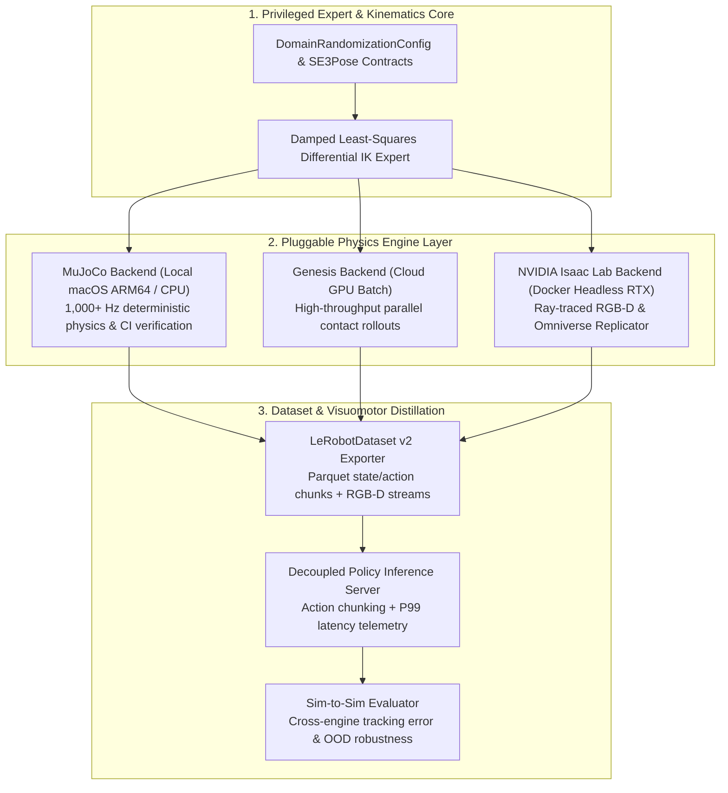

# Sim2Real Data Engine

[](https://www.python.org/downloads/)
[](https://mypy-lang.org/)
[](https://docs.astral.sh/ruff/)
[](LICENSE)

**Modular Synthetic Data Generation, Multi-Engine Physics Benchmarking & Visuomotor Distillation Framework for Embodied AI.**

---

## Overview

Modern visuomotor robot policies (Action Chunking Transformers, Diffusion Policies, Flow-Matching VLAs) are bottlenecked not by neural architecture capacity, but by the **quantity, physical diversity, and telemetry fidelity of demonstration trajectories**.

`sim2real-data-engine` bridges classical robotics and foundation policy learning by decoupling **privileged SE(3) trajectory experts** and **domain randomization schedules** from the underlying physics engine:

- **Problem:** Scripted experts and dataset collectors are typically tightly coupled to a single simulator API, making it difficult to validate contact physics across engines or develop locally without expensive workstation GPUs.
- **Solution:** A strictly typed contract and adapter architecture that lets you develop, test, and verify kinematics, domain randomization, and `LeRobotDataset` serialization **locally on Apple Silicon (`MuJoCo` at 1,000+ Hz)**, then burst identical workload manifests to **cloud GPUs (`Genesis` and `NVIDIA Isaac Lab`)** for massive parallel rollout generation and photorealistic RTX rendering.

---

## System Architecture



---

## Hybrid Local-Mac + Cloud-GPU Workflow

| Stage | Target Compute | Physics Backend | Primary Purpose |
| :--- | :--- | :--- | :--- |
| **1. Core Dev & CI** | Apple Silicon (M-Series) / CPU | `mujoco` | Develop SE(3) planners, domain randomization schedules, dataset schemas, and run 100% of unit tests at zero cloud cost. |
| **2. Parallel Contact Sweep** | Cloud GPU (`g5.xlarge` / `L4`) | `genesis` | Execute 10,000+ parallel randomized trajectories to stress-test friction, mass, and damping robustness. |
| **3. Photorealistic RGB-D** | Cloud GPU Headless Container | `isaac_lab` | Generate ray-traced visual observations under randomized lighting and textures for visuomotor distillation. |

---

## Quickstart

### Prerequisites

- **Python 3.13+** managed via [`uv`](https://docs.astral.sh/uv/)

### Installation & Verification

```bash
# 1. Install dependencies and development tooling
uv sync --dev

# 2. Run the deterministic test suite
uv run pytest -q --maxfail=1

# 3. Run linter and strict static type checks
uv run ruff check src tests
uv run mypy src
```

### CLI Usage

Inspect registered simulator backends and validate domain randomization configurations from the terminal:

```bash
# Display framework summary
uv run sim2real info

# List supported physics backends in JSON format
uv run sim2real backends --json

# Validate a seeded domain randomization configuration
uv run sim2real validate-config --seed 42 --mass-scale-min 0.8 --mass-scale-max 1.25 --json
```

---

## Repository Structure

```text
sim2real-data-engine/
├── CLAUDE.md                        # Operational manifest & module boundaries
├── AGENTS.md                        # 6-phase SDD execution protocol
├── README.md                        # Architecture overview & quickstart
├── pyproject.toml                   # Python 3.13 + uv + pytest + ruff + mypy config
├── src/
│   └── sim2real_engine/
│       ├── __init__.py
│       ├── cli.py                   # `sim2real` CLI entrypoint
│       └── core/
│           ├── __init__.py
│           └── contracts.py         # SE3Pose, JointState, DR config & step schemas
└── tests/
    └── test_contracts_and_cli.py    # Unit & CLI verification suite
```

## License

Released under the [MIT License](LICENSE).
