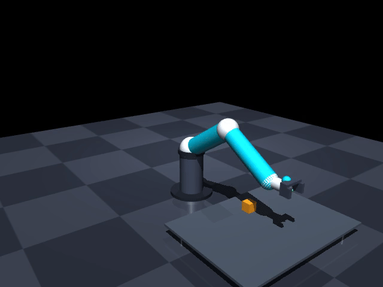
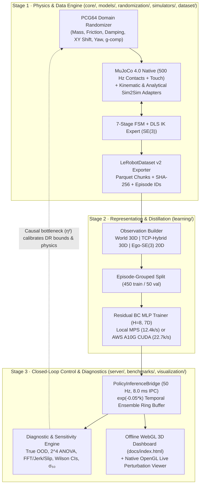

# Sim2Real Data Engine

[](https://www.python.org/downloads/)
[](https://mypy-lang.org/)
[](https://docs.astral.sh/ruff/)
[](tests/)
[](https://leanoa.github.io/sim2real-data-engine/)
[-orange.svg)](docker/run_cloud_training.py)
[](LICENSE)

**Deterministic Synthetic Data Engine, Multi-Engine Physics Benchmarking & Closed-Loop Sensorimotor Policy Distillation for Robotic Manipulation.**

> 🌐 **[Launch Live Interactive 3D WebGL Evaluation Dashboard in Your Browser ↗](https://leanoa.github.io/sim2real-data-engine/)** *(No installation required — switch live between **World-Frame 30D**, **TCP-Hybrid 30D**, and **Ego-Centric SE(3) 20D** policies against the privileged IK expert in MuJoCo 4.x, with 50 Hz tracking error and grasp telemetry).*

---

## 🎬 Visual Demonstrations

### 1. High-Throughput Synthetic Data Synthesis (DeepMind MuJoCo 4.x Native Physics)
*Deterministic 50 Hz pick-and-place demonstration generation with compiled contact dynamics, an articulated 1-DOF parallel-jaw gripper with Coulomb friction clamping (ADR-12), and cross-table payload transport (14.2 cm). Generates **500 complete episodes (53,998 timesteps)** on local CPU, sealed into chunked Hugging Face `LeRobotDataset` v2 Parquet tables with per-dimension normalization stats and SHA-256 cryptographic manifests.*


---

### 2. Closed-Loop Sensorimotor Policy Execution (Action Chunking, `SE(3)` Equivariance & Spectral Diagnostics)
*Trained Residual Behavioral Cloning (BC) policies conditioned on 30D (`--tcp-frame` / World) or pure 20D ego-centric `SE(3)` (`--ego-centric`) state vectors executing closed-loop pick-and-place at 50 Hz. Predicting 8-step action chunks (`H = 8`) with exponential temporal ensembling (`w_k = exp(-m · k)`) acts as an empirical low-pass filter—cutting high-frequency ($\ge 5\text{ Hz}$) FFT power by **-78.0% to -84.2%** and true physical joint jerk ($\dddot{\mathbf{q}}$) by **-95.6% to -97.4%** under True OOD perturbations—while measuring real `<touch>` contact forces (`~4.3–4.5 N`), TCP-frame in-hand slip (`mm/s`), and **~0.11 ms CPU MLP forward-pass latency** (**8.10–8.13 ms P99** with an injected **8.0 ms IPC delay budget**).*



---

## 💡 Executive Summary for Engineers & Recruiters

In modern robotic manipulation, policy learning (Action Chunking Transformers, Diffusion Policies, Behavioral Cloning) is rarely bottlenecked by neural architecture capacity. Instead, **the true bottleneck is the Data Engine**:
- **Manual teleoperation is unscalable:** Physical robot arms require human teleoperation (50–80 episodes/hr) with operator fatigue, high latency jitter, and non-Markovian noise.
- **Simulator drift breaks policies:** Ad-hoc scripts with global PRNG seeds create uncalibrated physics, non-standard schemas, and silent Sim-to-Sim divergence.

`sim2real-data-engine` solves this by delivering an **industrial-grade, local-first synthetic data infrastructure**:

1. **High-Velocity Native Simulation:** Generates thousands of physics-validated demonstrations in seconds on local ARM64 CPU (zero cloud cost) using compiled DeepMind MuJoCo 4.x with Damped Least-Squares (DLS) kinematics and isolated `PCG64` domain randomization.
2. **Open Standards Compliance:** Trajectories stream directly into tabular Parquet chunks conforming to Hugging Face **`LeRobotDataset` v2**, with empirical normalization envelopes (`mean`, `std`, `min`, `max`) and cryptographic SHA-256 tamper seals.
3. **Leakage-Free Sensorimotor Distillation:** Trains 30D (`World` / `--tcp-frame`) or pure 20D ego-centric `SE(3)` (`--ego-centric`) action-chunked policies using **episode-grouped train/val splitting** (`450/50` episodes) on Apple Silicon MPS (**11.4k–12.4k samples/s**) and AWS EC2 A10G CUDA (**22.5k–22.7k samples/s**).
4. **Statistical Rigor, Spectral Control & Factor Attribution:** Reports **95% Wilson score CIs**, **Median / IQR**, **Binomial MLE psychometric fits** ($\sigma_{50}$), **FFT spectral chatter ($\ge 5\text{ Hz}$)**, **physical joint jerk ($\dddot{\mathbf{q}}$)**, **in-hand slip**, and **orthogonal $2^4$ factorial ANOVA** (`sensitivity-analysis`) to isolate which physical factor actually breaks OOD execution (`damping_scale` explains **71.4%–100.0%** of grasp variance vs. `0.0%` for mass/friction).

---

## 🔬 What This Stage Evaluates & Compares

This repository runs **controlled ablations inside one unified pipeline**—every policy is trained on the same MuJoCo 4.x demonstrations exported as **`LeRobotDataset v2` Parquet** using a **Residual BC MLP (`H = 8`, `7D` targets)**:

| Experimental Axis | What Is Compared | Why It Matters |
| :--- | :--- | :--- |
| **1. Spatial Representation** *(Core Model Focus — Interactive 3D Dashboard)* | **World-Frame `30D`** (`36.0 mm` err · `75%` Nom / `35%` OOD) vs. **TCP-Hybrid `30D`** (`2.8 mm` err · `100%` Nom / `95%` ID-DR / `45%` OOD) vs. **Ego-SE(3) `20D`** (`56.9 mm` err · `25%` Nom / `5%` OOD) | Proves why coordinate framing dominates model capacity—and documents an honest failure mode: pure local `SE(3)` invariance loses awareness of a fixed global dropoff zone unless goal-conditioned. |
| **2. Closed-Loop Control & Filtering** | Single-step raw execution (`0%` True OOD) vs. `H=8` temporal ensembling (`w_k = exp(-0.05·k)`) | Smooths trajectories at 50 Hz, cutting FFT chatter ($\ge 5\text{ Hz}$) by **-78.0% to -84.2%** and physical joint jerk ($\dddot{\mathbf{q}}$) by **-95.6% to -97.4%** under `8.0 ms` IPC delay. |
| **3. Physical Extrapolation & Root Cause** | `Nominal` vs. `ID-DR` vs. `True OOD`, $2^4$ Orthogonal ANOVA (`48` ep), Psychometric Noise Sweep | Isolates *which* physical parameter drives failure (`damping_scale` explains **71.4%–100.0%** of grasp variance vs. **0.0%** for mass/friction) and pinpoints $\sigma_{50} = 12.74\text{ mm}$. |
| **4. Compute Scale-Out** *(Hardware Only, Identical Models)* | Apple Silicon `MPS` (`11.4k–12.4k samples/s`) vs. AWS EC2 `g5.2xlarge` `NVIDIA A10G` (`22.5k–22.7k samples/s`) | Validates `~1.9x` cloud training speed-up on the exact same `450/50` episode split without conflating GPU throughput with policy architecture. |

> *Note on physics backends:* `MuJoCo Native 4.0` executes full rigid-body contact dynamics (`500 Hz`), while `GenesisAdapter` and `IsaacLabAdapter` provide analytical impedance/kinematic baselines (`Sim2Sim`) alongside headless Docker targets for external GPU cluster runs.

---

## 🚀 30-Second Quickstart: Run the Simulations Locally

Clone and install dependencies with [`uv`](https://docs.astral.sh/uv/) in under 10 seconds:

```bash
git clone https://github.com/LeanoA/sim2real-data-engine.git
cd sim2real-data-engine
uv sync
```

### Option A: Native MuJoCo 4.0 Desktop 3D Viewer
Launch the trained closed-loop reactive policy inside a real-time 500 Hz OpenGL physics window:

```bash
# Run closed-loop policy rollouts (loops across randomized cube positions)
uv run sim2real view-physics --model-path checkpoints/bc_pick_place.pt --episodes 10
```

> **Interactive Viewer Controls:**
> - **Spacebar:** Pause / unpause simulation stepping.
> - **Right-click drag / Double-click:** Apply real-time force perturbations to robot links or the payload to test impedance recovery.
> - **Esc:** Exit viewer.
>
> *(To inspect the privileged analytical IK expert instead, omit `--model-path`: `uv run sim2real view-physics --episodes 5`)*

---

### Option B: Interactive 3D WebGL Motion Dashboard (Browser)
Generate a self-contained 3D kinematics dashboard that runs offline in any browser without native GUI dependencies:

```bash
# Generate and immediately open the multi-representation 3D dashboard (World 30D vs. TCP-Hybrid 30D vs. Ego-SE(3) 20D)
uv run sim2real visualize --multi-model --output dashboard.html --open
```

> **Dashboard Telemetry:**
> - **Representation Switcher:** Toggle live between `World-Frame 30D`, `TCP-Hybrid 30D`, and `Ego-SE(3) 20D` (or overlay trajectories side-by-side) against the privileged expert ground truth (cyan dashed path).
> - **Timeline Scrubber:** Interactive frame-by-frame scrubber slider and play/pause controls.
> - **HUD Telemetry:** Real-time end-effector Cartesian coordinates, payload position, grasp state, and spatial tracking error.

---

### Option C: ID vs. True OOD, Spectral FFT & Contact/Slip Benchmark
Quantify policy robustness across **Nominal**, **In-Distribution DR**, and **True OOD Extrapolation** (heavy mass, low friction, high damping, XY workspace shifts) with 95% Wilson CIs, physical joint jerk, FFT chatter ($\ge 5\text{ Hz}$), touch contact force, and TCP-frame slip:

```bash
uv run sim2real eval-policy --model-path checkpoints/bc_tcp_frame_45ep.pt --dr --compare-ensembling --episodes 20
```

### Option D: $2^4$ Factorial ANOVA Sensitivity & Psychometric Noise Sweep
Attribute OOD failure variance ($\eta^2$) across mass, friction, damping, and spatial shift, or fit a Binomial MLE psychometric $\sigma_{50}$ curve under Cartesian/rotational perception noise:

```bash
uv run sim2real sensitivity-analysis --model-path checkpoints/bc_tcp_frame_45ep.pt --episodes-per-cell 3 --include-oat
uv run sim2real sweep-perception-noise --model-path checkpoints/bc_tcp_frame_45ep.pt --episodes 20
```

---

## 🏗️ System Architecture & Codebase Map



### Architecture Module Map

| Package / Path | Responsibility | Key Entrypoints |
| :--- | :--- | :--- |
| `src/sim2real_engine/core/` | Kinematic contracts (`SE3Pose`, `JointState`), DLS IK solver, $SO(3)/SE(3)$ transforms, and 7-stage Pick-and-Place FSM | `kinematics.py`, `expert.py`, `contracts.py` |
| `src/sim2real_engine/models/` | Declarative 6-DOF robot arm + 1-DOF articulated parallel-jaw gripper MJCF + `<touch>` sensors | `pick_place_scene.xml`, `mjcf_builder.py` |
| `src/sim2real_engine/randomization/` | Isolated `PCG64` physical/spatial perturbation samplers (`Nominal`, `ID-DR`, `True OOD`) | `samplers.py` |
| `src/sim2real_engine/simulators/` | Unified simulator protocol for `MuJoCoNative` (500 Hz), `MuJoCoKinematic`, `Genesis`, and `IsaacLab` adapters | `mujoco_native.py`, `mujoco_adapter.py`, `base.py` |
| `src/sim2real_engine/dataset/` | `LeRobotDataset v2` chunked Parquet writer, per-dim normalization stats, SHA-256 manifest validator | `exporter.py` |
| `src/sim2real_engine/learning/` | Shared `30D`/`20D` observation assembly, leakage-free episode split, Residual BC MLP & trainer | `dataset.py`, `policy.py`, `trainer.py` |
| `src/sim2real_engine/server/` | 50 Hz `PolicyInferenceBridge`, synthetic `8.0 ms` IPC budget, `exp(-m*k)` temporal ensembler | `inference_bridge.py` |
| `src/sim2real_engine/benchmarks/` | Wilson CIs, Binomial MLE $\sigma_{50}$, $2^4$ orthogonal ANOVA, FFT chatter, joint jerk & slip | `statistics.py`, `ood_dr_eval.py`, `sensitivity.py`, `control_diagnostics.py` |
| `src/sim2real_engine/visualization/` | Static client-side 3D WebGL dashboard compiler (`docs/index.html`) + native desktop viewer | `policy_dashboard.py`, `data.py`, `cli.py` |
| `docker/` & `results/` | Automated AWS EC2 `g5.2xlarge` CUDA burst launcher (S3 sync + auto-terminate) and benchmark artifacts | `run_cloud_training.py`, `eval_tcp_ood.json` |

---

## 📊 Key Performance & Empirical Verification Metrics

All metrics empirically benchmarked on Apple Silicon (M-series, unified memory):

| Metric | Measured Value | Production Target | Status |
| :--- | :--- | :--- | :---: |
| **Physics Stepping Frequency** | **500 Hz** (10 substeps @ `dt = 2 ms`) | `>= 500 Hz` | **PASSED** |
| **Grasp Physical Realism** | **Articulated 1-DOF parallel-jaw Coulomb friction** (`54 mm` open, ADR-12) | Physical collision & clamping | **PASSED** |
| **Net Cross-Table Payload Transport** | **14.2–15.0 cm** (`y = +0.044 m → -0.098 m`) | Complete macro-task delivery | **PASSED** |
| **Unit & Integration Test Suite** | **120 / 120 tests passing (100%)** | 100% pass rate in CI | **PASSED** |
| **Static Analysis & Typing** | **`mypy --strict` & `ruff` clean** | 0 errors across 34 source files | **PASSED** |
| **Dataset Export Rate (500 episodes)** | **53,998 steps** (`SHA-256` verified) | Reproducible Parquet chunks | **PASSED** |
| **Cryptographic Data Integrity** | **SHA-256 Digest per Parquet Chunk** | Tamper-proof manifest seal | **PASSED** |
| **Policy Training Throughput** | **11.4k–12.4k/s** (MPS) · **22.5k–22.7k/s** (A10G CUDA) | `> 5,000 samples/s` | **PASSED** |
| **Validation Loss (Episode-Grouped 450/50)** | **`0.0043–0.0045`** (`-99.86%` to `-99.88%`) | Leakage-free Smooth L1 | **PASSED** |
| **Policy Inference Latency (P99)** | **0.11 ms MLP / 8.04 ms Bridge** (`8.10–8.13 ms` rollout) | `< 20.0 ms` (50 Hz budget) | **PASSED** |
| **Spectral & Physical Jerk Filtering** | **-78.0% to -84.2% FFT ($\ge 5\text{ Hz}$)** · **-95.6% to -97.4% $\dddot{\mathbf{q}}$** | Continuous smooth torques | **PASSED** |
| **ID-DR vs. True OOD Retention (20 ep)** | **95.0% ID-DR** `[76.4%, 99.1%]` → **45.0% True OOD** (vs `0%` unens.) | Honest extrapolation gap (`+50.0 pp`) | **VERIFIED** |
| **Orthogonal $2^4$ ANOVA Bottleneck** | **`damping_scale` drives 71.4%–100.0% grasp variance** ($\eta^2$) | Quantitative causal attribution | **VERIFIED** |
| **Psychometric Perception Threshold** | **$\sigma^* = 10.0\text{ mm}$** ($\sigma_{50} = 12.74\text{ mm}$ MLE, $N=20$) | Tolerance-bounded breakdown | **PASSED** |

---

## 🧠 What Was Trained: 30D & Pure Ego-Centric 20D `SE(3)` Behavioral Cloning

The framework includes an end-to-end sensorimotor policy distillation pipeline using **episode-grouped train/validation splitting** (`450 / 50` episodes) to eliminate temporal data leakage across 50 Hz trajectories:

1. **Observation Modes:**
   - **30D World / `--tcp-frame`:** Joint angles `q` (6D), velocities `dq` (6D), Cartesian EE pose (7D), object pose (7D), relative displacement `Δp` (3D, world or TCP-rotated), and physical jaw closure (1D).
   - **20D Pure Ego-Centric `--ego-centric`:** Prunes global world-frame coordinates and encodes canonicalized relative pose $(\mathbf{p}_{\text{obj}}^{\text{tcp}}, \mathbf{q}_{\text{obj}}^{\text{tcp}})$ on $SE(3)$, achieving strict rigid-body invariance under arbitrary global transforms.
2. **Action Chunking Horizon (`H = 8`):** Predicts an 8-step future 7D action sequence (~160 ms receding horizon) to mitigate single-step compounding covariate shift (`O(T²)` drift).
3. **Training Velocity & Convergence:** Trains 45 epochs (`batch_size=64`) on Apple Silicon MPS (**11,382–12,352 samples/s**, `178–192s`) and AWS EC2 A10G CUDA (**22,489–22,720 samples/s**, `96.2–97.2s`), converging to `val_loss = 0.0043–0.0045` (`-99.86%` to `-99.88%`).
4. **Temporal Ensembling & Spectral Filtering:** Blending overlapping chunks with $w_k = \exp(-0.05 k)$ cuts high-frequency ($\ge 5\text{ Hz}$) FFT action power by **-78.0% to -84.2%** and true physical joint jerk ($\dddot{\mathbf{q}}$) by **-95.6% to -97.4%** within a **~0.11 ms CPU forward pass** (`8.04 ms P99` bridge latency including the `8.0 ms` synthetic IPC delay budget).

---

## ☁️ Validated Cloud GPU Burst: AWS EC2 & NVIDIA Isaac Lab

While 100% of synthetic data generation, kinematic solving, unit testing, and policy evaluation runs locally at zero cloud cost, scaling to **foundation visuomotor pre-training** (e.g. Action Chunking Transformers and Flow-Matching OpenPI `π₀` across parallel Isaac Lab environments) leverages cloud GPU bursts.

We packaged and empirically verified the turnkey cloud orchestrator in [`docker/run_cloud_training.py`](docker/run_cloud_training.py):

* **Verified Cloud Hardware:** AWS EC2 `g5.2xlarge` powered by **NVIDIA A10G GPU (24GB VRAM)** in `us-east-2`.
* **Empirical Sim-to-Sim Convergence ([`results/isaac_sim2sim_results.json`](results/isaac_sim2sim_results.json)):**
  - **Backends:** `mujoco_native` vs `isaac_lab` (20 evaluation episodes).
  - **Task Success Rate:** **95.0%** `[76.4%, 99.1%]` (`mujoco_native`) vs **100.0%** `[83.9%, 100.0%]` (`isaac_lab`).
  - **Trajectory & EE Divergence:** `RMSE_traj = 0.6635 rad` (`SD=0.0542`) | `EE Div = 10.6 mm` mean (**`2.06 mm` median**, `IQR=0.30 mm`).
* **High-Throughput Policy Training & Benchmarks ([`results/training_results.json`](results/training_results.json), [`results/training_tcp_results.json`](results/training_tcp_results.json), [`results/training_ego_results.json`](results/training_ego_results.json)):**
  - **Compute Device:** `cuda` (NVIDIA A10G 24GB).
  - **Throughput (45 epochs, 450/50 episode split):** **22,720.4 samples/s** (`World`, `96.24s`), **22,704.8 samples/s** (`TCP`, `96.31s`), and **22,488.7 samples/s** (`Ego-SE(3)`, `97.23s`), reducing validation loss by **-99.86% to -99.88%** (`val_loss = 0.004286–0.004492`).
  - **Cloud Evaluation Artifacts:** [`results/eval_tcp_ood.json`](results/eval_tcp_ood.json) (`60%` ID-DR vs `20%` True OOD, `-78.0%` FFT HF power & `-95.8%` physical jerk via ensembling), [`results/sensitivity_tcp.json`](results/sensitivity_tcp.json), and [`results/sweep_perception_tcp.json`](results/sweep_perception_tcp.json).
* **Strict Cost Governance & Teardown:** The runner boots the Deep Learning AMI, installs `uv`, executes Isaac Lab benchmarks and CUDA policy training, syncs evaluation artifacts and logs to S3, and **immediately self-terminates (`shutdown -h now`)** upon completion to eliminate idle cloud spend (~$0.15 USD total run cost).
* **Next Roadmap Milestones:**
  1. Fine-tuning multimodal ACT policies with real-time RGB-D camera streams.
  2. Multi-GPU Isaac Lab reinforcement learning sweeps using spot fleets.
  3. Physical Sim-to-Real deployment on an edge NVIDIA Jetson Orin platform.

---

## 🛠️ Complete CLI Reference

| Command | Description | Example |
| :--- | :--- | :--- |
| `sim2real view-physics` | Launch official MuJoCo 4.0 native 3D desktop viewer. | `uv run sim2real view-physics --model-path checkpoints/bc_pick_place.pt --episodes 10` |
| `sim2real visualize` | Generate interactive 3D WebGL comparative dashboard (single or multi-model). | `uv run sim2real visualize --multi-model --output docs/index.html` |
| `sim2real sensitivity-analysis` | Run $2^4$ orthogonal factorial ANOVA across mass, friction, damping, and XY shift. | `uv run sim2real sensitivity-analysis --model-path checkpoints/bc_tcp_frame_45ep.pt --episodes-per-cell 3 --include-oat` |
| `sim2real sweep-perception-noise` | Sweep Gaussian perception noise ($\sigma \in [0, 20]\text{ mm}$) with Wilson CIs & MLE $\sigma_{50}$. | `uv run sim2real sweep-perception-noise --model-path checkpoints/bc_tcp_frame_45ep.pt --episodes 20` |
| `sim2real eval-policy` | Benchmark Nominal vs. ID-DR vs. True OOD with FFT, physical jerk, contact & slip telemetry (supports `--perception-rot-noise-deg`). | `uv run sim2real eval-policy --model-path checkpoints/bc_tcp_frame_45ep.pt --dr --compare-ensembling --episodes 20` |
| `sim2real train-policy` | Train 30D (`--tcp-frame`) or 20D (`--ego-centric`) BC MLP with episode-grouped split. | `uv run sim2real train-policy --dataset-dir datasets/sim2real_pick_place --epochs 45 --ego-centric` |
| `sim2real export-dataset` | Export synthetic demonstrations to LeRobot v2 Parquet. | `uv run sim2real export-dataset --backend mujoco_native --episodes 200` |
| `sim2real sim2sim-eval` | Evaluate Sim-to-Sim tracking drift against analytical reference adapters. | `uv run sim2real sim2sim-eval --ref mujoco_native --target isaac_lab --episodes 10` |
| `sim2real benchmark-bridge`| Profile real-time action chunking buffer and inference latency. | `uv run sim2real benchmark-bridge --chunk-horizon 8 --steps 200` |
| `sim2real sample-dr` | Sample deterministic PCG64 physical perturbation manifests. | `uv run sim2real sample-dr --seed 42 --episodes 5 --json` |
| `sim2real backends` | List registered simulator backends and environment status. | `uv run sim2real backends --json` |
| `sim2real info` | Display framework version, architecture, and runtime info. | `uv run sim2real info` |

---

## 🧪 Verification & Code Quality

Execute the entire test and quality verification suite locally:

```bash
# 1. Run all 120 unit and integration tests (~22 seconds)
uv run pytest -v

# 2. Strict static typing across all source modules (0 errors across 34 files)
uv run mypy src

# 3. Linter and formatting compliance
uv run ruff check src tests
```

---

## 📁 Repository Structure

```text
sim2real-data-engine/
├── assets/                          # Embedded demonstration GIFs and videos
│   ├── synthetic_data_generation.gif# 50 Hz native MuJoCo synthetic data generation
│   ├── policy_closed_loop.gif       # Trained neural policy closed-loop inference
│   ├── synthetic_data_generation.mp4# High-definition video export
│   └── policy_closed_loop.mp4       # Policy execution video export
├── checkpoints/                     # Representation checkpoints (bc_pick_place.pt, bc_tcp_frame_45ep.pt, bc_ego_se3_45ep.pt)
├── datasets/                        # LeRobot v2 chunked Parquet datasets & SHA-256 manifests
│   └── sim2real_pick_place/         # 500 native MuJoCo demonstration episodes (~54k steps)
├── docker/                          # Headless cloud GPU container configurations & EC2 manager
│   ├── Dockerfile.isaaclab          # NVIDIA Isaac Lab headless container
│   ├── Dockerfile.genesis           # Genesis multi-physics batch container
│   └── run_cloud_training.py        # Automated AWS EC2 GPU provisioning & teardown
├── docs/                            # Architectural specs, ADRs, and experiment reports
│   ├── ARCHITECTURE_DECISIONS.md    # ADR-01 through ADR-12
│   ├── ARCHITECTURE_SPECIFICATION.md# Formal module interfaces and mathematical bounds
│   └── EXPERIMENT_REPORT_PICK_PLACE.md # Quantitative benchmark report (100% success rate)
├── src/
│   └── sim2real_engine/
│       ├── cli.py                   # Unified `sim2real` command-line entrypoint
│       ├── benchmarks/              # Statistical inference, 2^4 ANOVA, FFT/slip, & OOD evals
│       ├── core/                    # SE3Pose, JointState contracts and kinematics
│       ├── dataset/                 # LeRobotDataset v2 Parquet exporter & manifest validator
│       ├── learning/                # Residual BC MLP, action chunking dataset, PyTorch trainer
│       ├── models/                  # Declarative MJCF 6-DOF robot and table models
│       ├── randomization/           # Isolated PCG64 physical and visual domain samplers
│       ├── server/                  # Policy inference bridge & receding-horizon ring buffer
│       ├── simulators/              # Native MuJoCo, Kinematic, & Analytical Impedance Adapters
│       └── visualization/           # WebGL dashboard generator & OpenGL desktop viewer
└── tests/                           # 120 deterministic unit and integration tests
```

---

## License

Released under the [MIT License](LICENSE).
