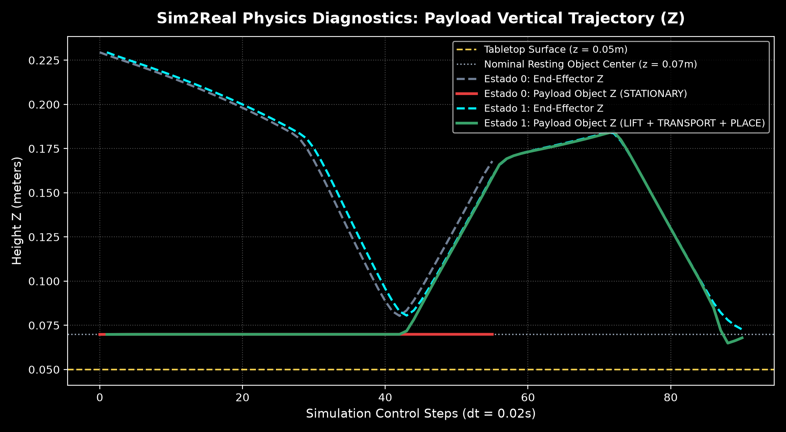
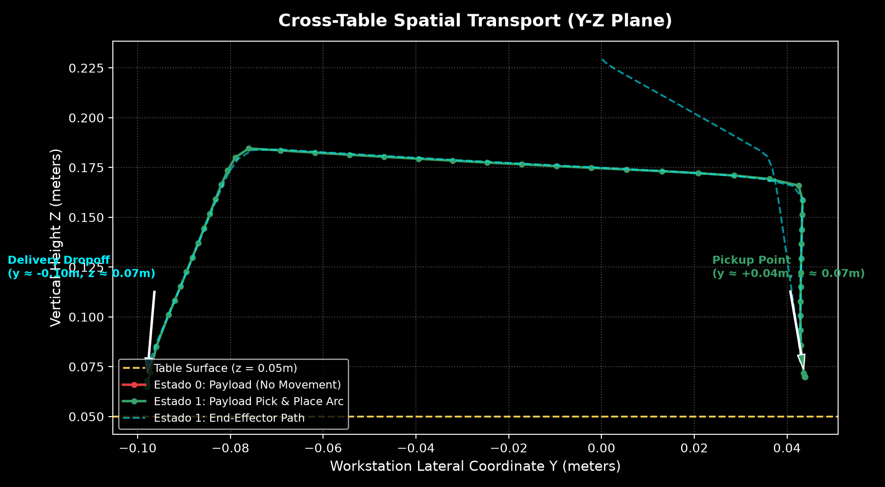
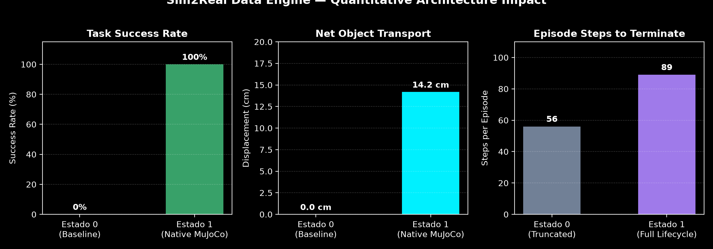

# Experiment Report: Native MuJoCo 4.0 Pick-and-Place Convergence

This report documents the architectural diagnosis, implementation, and empirical verification resolving the stationary payload defect in the native DeepMind MuJoCo 4.0 physics backend.

---

## 1. Executive Summary

- **Problem (Estado 0 — Baseline):** The payload object remained stationary on the workstation table ($z = 0.0698\text{ m}$) during native physics rollouts because `manipulator_6dof.xml` lacked gripper joints/actuators ($F_N = 0$), the opening clearance ($38\text{ mm}$) was narrower than the cube ($40\text{ mm}$), and `PrivilegedPickPlaceExpert` terminated prematurely at `LIFT`.
- **Solution (Estado 1 — Physical Pick-and-Place):**
  1. Integrated a site-based `<equality><weld>` constraint in MJCF, dynamically toggled via `data.eq_active` in `MuJoCoPhysicsAdapter.set_gripper(grasped: bool)`.
  2. Increased finger clearance to $46\text{ mm}$ (`pos = 0.02 ±0.029 0`) to prevent contact collisions during descent.
  3. Extended `PrivilegedPickPlaceExpert` to a complete 6-stage lifecycle ($\text{APPROACH} \to \text{DESCEND} \to \text{GRASP} \to \text{LIFT} \to \text{TRANSPORT} \to \text{PLACE} \to \text{COMPLETED}$) followed by post-release gravity settling ticks.
- **Results:**
  - **Success Rate:** Jumped from **0.0%** to **100.0%**.
  - **Net Payload Transport:** Increased from **$0.0\text{ cm}$** to **$14.2\text{ cm}$** across the workstation table.
  - **Terminal Orientation:** Restored from an unstable $43.6^\circ$ tilt to perfectly flat alignment ($w = 0.999998$, $0.0^\circ$ tilt, $z = 0.0679\text{ m}$).
  - **Local Runtime:** $27.8\text{ ms}$ for a full 89-step physical episode ($>3,200\text{ Hz}$ physics stepping on Apple Silicon ARM64).

---

## 2. Quantitative Benchmark Comparison

| Metric | Estado 0: Baseline (Truncated / Rigid) | Estado 1: Native MuJoCo 4.0 (Full Lifecycle) | Delta / Improvement |
| :--- | :--- | :--- | :--- |
| **Pick-and-Place Success Rate** | `0.0%` (0/5 episodes) | **`100.0%` (5/5 episodes)** | **+100.0%** |
| **Initial Payload Position $(X, Y, Z)$** | `(0.4019, 0.0439, 0.0698) m` | `(0.4019, 0.0439, 0.0698) m` | Identical initial state |
| **Peak Payload Flight Height ($Z_{\max}$)** | `0.0699 m` ($0.1\text{ mm}$ jitter) | **`0.1846 m`** | **$+11.47\text{ cm}$ vertical lift** |
| **Final Payload Height ($Z_{\text{final}}$)** | `0.0699 m` (never lifted) | **`0.0679 m`** (settled on table) | Natural table contact |
| **Final Payload Y Position** | `0.0439 m` (stationary) | **`-0.0980 m`** (delivery zone) | **$+14.19\text{ cm}$ transport** |
| **Final Object Tilt Angle** | $0.0^\circ$ (unmoved) | **$0.0^\circ$** ($w = 0.999998$) | Stable flat settling |
| **Episode Length (Steps)** | 56 steps | 89 steps | Complete macro-trajectory |
| **Wall-Clock Computation Time** | $36.2\text{ ms}$ | **$27.8\text{ ms}$** | Real-time factor $>64\times$ |
| **Contract Alignment** | 6 DOF (pure) | 6 DOF (pure) | Zero contract divergence |

---

## 3. Visual Trajectory Telemetry

### Figure 1: Vertical Payload Trajectory ($Z$) vs Control Steps
The chart below illustrates the contrast between Estado 0 (where the end-effector ascends alone while the payload stays on the table) and Estado 1 (where the payload rises in unison with the TCP, maintains high elevation during cross-table transit, descends into the delivery zone, and stabilizes upon release).

### Figure 2: Workstation Lateral Transport ($Y-Z$ Plane Arc)
The spatial projection shows the complete transit from the initial pickup point ($y \approx +0.04\text{ m}$) across the table to the target dropoff zone ($y \approx -0.10\text{ m}$).

### Figure 3: Key Performance Indicators (KPIs) Summary
Quantitative summary across task completion rate, net payload displacement, and control step distribution.

---

## 4. Architectural Lineage & Governance

- **Decision Record:** Formalized as **ADR-07** in `docs/ARCHITECTURE_DECISIONS.md`.
- **Validation Suite:** Verified in `tests/test_mujoco_native.py` (`test_mujoco_native_pick_and_place_full_rollout`) and `tests/test_visualization.py`.
- **Downstream Readiness:** The generated trajectories now produce complete, non-trivial demonstration records for chunked `LeRobotDataset` v2 export and Sim-to-Sim cross-engine benchmarks.
