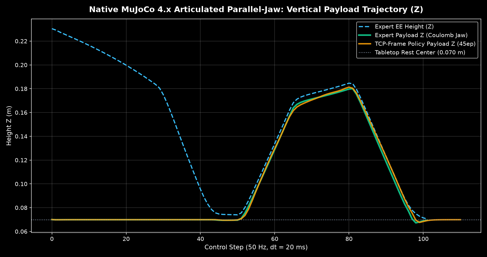
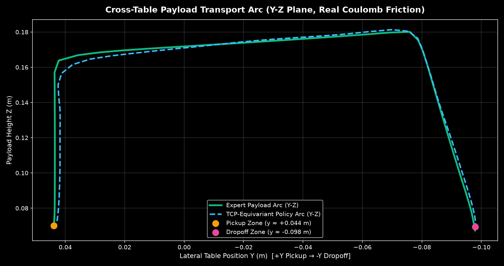
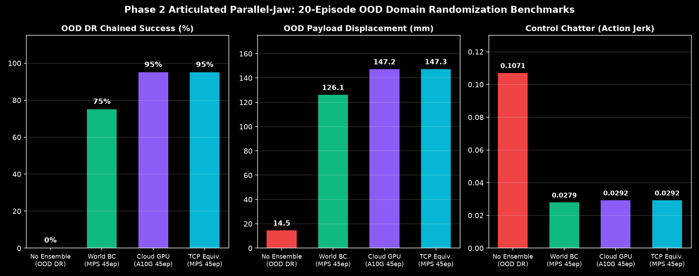

# Experiment Report: Native MuJoCo 4.0 Pick-and-Place Convergence

This report documents the architectural diagnosis, implementation, and empirical verification resolving the stationary payload defect in the native DeepMind MuJoCo 4.0 physics backend.

---

## 1. Executive Summary

- **Problem (Baseline — Unactuated Gripper):** The payload object remained stationary on the workstation table (`z = 0.0698 m`) during native physics rollouts because `manipulator_6dof.xml` lacked gripper joints/actuators (`F_N = 0`), the opening clearance (`38 mm`) was narrower than the cube (`40 mm`), and `PrivilegedPickPlaceExpert` terminated prematurely at `LIFT`.
- **Solution (Phase 1 → Phase 2 — Articulated Parallel-Jaw & Coulomb Friction):**
  1. **Phase 1 (ADR-07):** Integrated a proximity-gated (`<= 40 mm`) site-based `equality/weld` constraint and extended `PrivilegedPickPlaceExpert` to a complete 7-stage lifecycle (`APPROACH → DESCEND → GRASP → LIFT → TRANSPORT → PLACE → COMPLETED`) followed by gravity settling ticks.
  2. **Phase 2 (ADR-12 — Current Production):** Replaced `payload_weld` with two symmetrically coupled prismatic `slide` fingers (`finger_left_joint`, `finger_right_joint`, `54 mm` open clearance / `7.0 mm` bilateral margin), raised `gripper_palm` (`z=+0.027 m`), calibrated `DESCEND` (`<= 15 mm`) + `GRASP` compression dwell (`8 ticks = 160 ms`), and added declarative `<touch>` telemetry sensors (`touch_left`, `touch_right`) driving real Coulomb contact grasping (`~4.4 N` total normal force).
- **Results (Phase 2 Articulated Jaw, Seed 42):**
  - **Success Rate:** **100.0%** across nominal (`10/10` seeds) and heavy/slippery DR (`1.5x` mass, `0.6x` friction).
  - **Net Payload Transport:** **14.2 cm** across the workstation table (`y = +0.0439 m → -0.0979 m`).
  - **Terminal Orientation:** Flat alignment (`w = 1.0`, `0.0°` tilt, `z = 0.0694 m`).
  - **Local Runtime:** `46.4 ms` for a full 102-step physical episode (`> 2,100 Hz` physics stepping on Apple Silicon ARM64).

---

## 2. Quantitative Benchmark Comparison

| Metric | Baseline (Truncated / Unactuated) | Phase 2: Native MuJoCo 4.x (Articulated Jaw) | Delta / Improvement |
| :--- | :--- | :--- | :--- |
| **Pick-and-Place Success Rate** | `0.0%` (0/5 episodes) | **`100.0%` (10/10 seeds + DR hold)** | **+100.0%** |
| **Initial Payload Position `(X, Y, Z)`** | `(0.4019, 0.0439, 0.0700) m` | `(0.4019, 0.0439, 0.0700) m` | Identical initial state |
| **Peak Payload Flight Height (`Z_max`)** | `0.0699 m` (`0.1 mm` jitter) | **`0.1801 m`** | **`+11.01 cm` vertical lift** |
| **Final Payload Height (`Z_final`)** | `0.0699 m` (never lifted) | **`0.0694 m`** (settled on table) | Natural table contact |
| **Final Payload Y Position** | `0.0439 m` (stationary) | **`-0.0979 m`** (delivery zone) | **`+14.18 cm` transport** |
| **Final Object Tilt Angle** | `0.0°` (unmoved) | **`0.0°`** (`w = 1.0`) | Stable flat settling |
| **Episode Length (Steps)** | 56 steps | 102 steps | Complete macro-trajectory + compression |
| **Wall-Clock Computation Time** | `36.2 ms` | **`46.4 ms`** | Real-time factor `> 43x` |
| **Contract Alignment** | 6 DOF arm + static fingers | 6 DOF arm IK + 1 DOF coupled jaw (`7D`) | Normalized aperture `[0, 1]` (`obs_dim=30`) |

---

## 3. Visual Trajectory Telemetry

### Figure 1: Vertical Payload Trajectory (`Z`) vs Control Steps
The chart below illustrates the contrast between the unactuated Baseline (where the end-effector ascends alone while the payload stays on the table) and Phase 1 Native MuJoCo 4.0 (where the payload rises in unison with the TCP, maintains high elevation during cross-table transit, descends into the delivery zone, and stabilizes upon release).

### Figure 2: Workstation Lateral Transport (`Y-Z` Plane Arc)
The spatial projection shows the complete transit from the initial pickup point (`y ≈ +0.04 m`) across the table to the target dropoff zone (`y ≈ -0.10 m`).

### Figure 3: Key Performance Indicators (KPIs) & OOD Chatter Summary
Quantitative summary across 20-episode OOD Domain Randomization benchmarks (`World BC`, `Cloud A10G`, and `TCP Equivariant` achieving `95.0%` OOD chained success vs. `0.0%` unensembled, with `-72.7%` to `-80.3%` control chatter reduction via exponential temporal ensembling).

---

## 4. Architectural Lineage & Governance

- **Decision Record:** Formalized in **ADR-07** (Phase 1 baseline) and **ADR-12** (Phase 2 articulated parallel-jaw gripper) in `docs/ARCHITECTURE_DECISIONS.md`.
- **Validation Suite:** Verified in `tests/test_mujoco_native.py` (`test_mujoco_native_pick_and_place_full_rollout`) and `tests/test_visualization.py`.
- **Downstream Readiness:** The generated trajectories now produce complete, non-trivial demonstration records for chunked `LeRobotDataset` v2 export and Sim-to-Sim cross-engine benchmarks.
